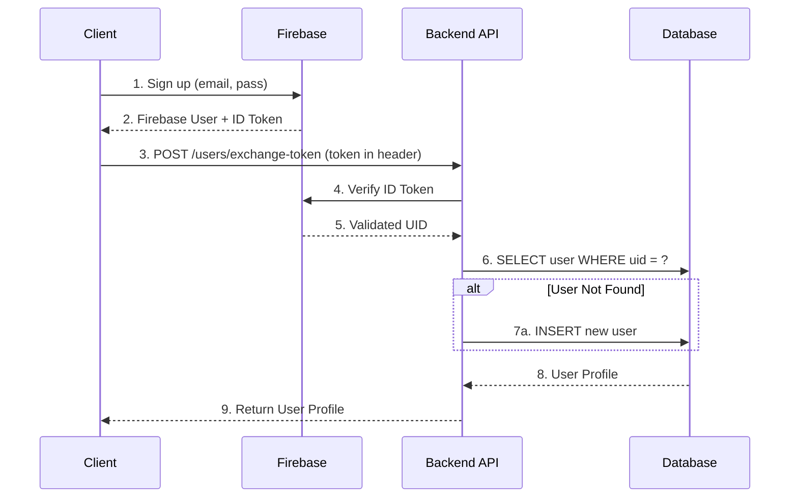
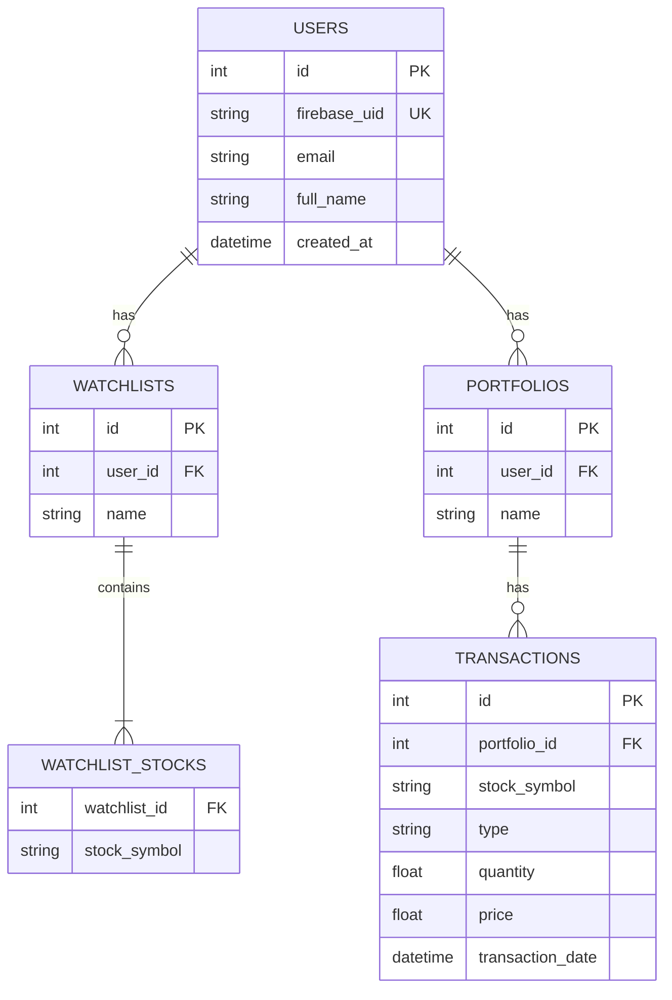

# StockerPro Backend API - Developer Guide

This document provides a comprehensive guide to the StockerPro Backend API, including setup, architecture, and available endpoints.

## 1. Authentication & Tokens

Authentication is handled via Firebase. Clients must obtain a Firebase ID token and include it in the `Authorization` header of all requests.

`Authorization: Bearer <FIREBASE_ID_TOKEN>`

The backend validates this token, extracts the user's UID, and uses it for authorization and data scoping.

### 1.1. User Registration & Token Exchange

1.  **Client-Side:** User signs up with Firebase (email/password, social).
2.  **Client-Side:** Firebase returns a `FirebaseUser` object.
3.  **Client-Side:** Client gets the ID token: `firebaseUser.getIdToken()`.
4.  **Backend Call:** Client sends the token to the `/api/v1/users/exchange-token` endpoint.
5.  **Backend Logic:**
    *   The backend validates the token with the Firebase Admin SDK.
    *   It checks if a user with this Firebase UID already exists in the `users` table.
    *   If not, it creates a new user record.
    *   It returns the full `User` profile from the database.

## 2. API Endpoints

All endpoints are prefixed with `/api/v1`.

### 2.1. Users

-   `POST /users/exchange-token`
    -   **Description:** Exchanges a Firebase ID token for an application user profile. This is the primary mechanism for user login and registration.
    -   **Authorization:** Firebase ID Token (Bearer)
    -   **Request Body:** None (token is from header)
    -   **Response:** `User` object
    -   **Error Codes:**
        -   `401 Unauthorized`: Invalid or expired token.
        -   `500 Internal Server Error`: Failure in token validation or database interaction.

### 2.2. Stocks

-   `GET /stocks/search`
    -   **Description:** Searches for stocks by symbol or name.
    -   **Authorization:** Required
    -   **Query Parameters:**
        -   `query`: The search term (e.g., "AAPL", "Apple Inc").
    -   **Response:** `Stock[]` - An array of matching stock objects.

-   `GET /stocks/quote/{symbol}`
    -   **Description:** Fetches real-time price and quote data for a given stock symbol.
    -   **Authorization:** Required
    -   **Path Parameters:**
        -   `symbol`: The stock ticker symbol (e.g., "AAPL").
    -   **Response:** `StockQuote` object.

-   `GET /stocks/intraday-prices/{symbol}`
    -   **Description:** Retrieves intraday (1-minute interval) price data for a stock.
    -   **Authorization:** Required
    -   **Path Parameters:**
        -   `symbol`: The stock ticker symbol.
    -   **Response:** `IntradayPricePoint[]`

-   `GET /stocks/historical-prices/{symbol}`
    -   **Description:** Retrieves historical daily price data for a stock.
    -   **Authorization:** Required
    -   **Path Parameters:**
        -   `symbol`: The stock ticker symbol.
    -   **Response:** `HistoricalPricePoint[]`

-   `GET /stocks/news/{symbol}`
    -   **Description:** Fetches recent news articles related to a stock.
    -   **Authorization:** Required
    -   **Path Parameters:**
        -   `symbol`: The stock ticker symbol.
    -   **Response:** `StockNews[]`

### 2.3. Watchlists

-   `GET /watchlists`
    -   **Description:** Retrieves all watchlists belonging to the authenticated user.
    -   **Authorization:** Required
    -   **Response:** `Watchlist[]`

-   `POST /watchlists`
    -   **Description:** Creates a new watchlist.
    -   **Authorization:** Required
    -   **Request Body:**
        -   `name`: `string` - The name of the new watchlist.
    -   **Response:** The newly created `Watchlist` object.

-   `DELETE /watchlists/{watchlist_id}`
    -   **Description:** Deletes a user's watchlist.
    -   **Authorization:** Required
    -   **Path Parameters:**
        -   `watchlist_id`: The ID of the watchlist to delete.

-   `POST /watchlists/{watchlist_id}/stocks`
    -   **Description:** Adds a stock to a specific watchlist.
    -   **Authorization:** Required
    -   **Path Parameters:**
        -   `watchlist_id`: The ID of the target watchlist.
    -   **Request Body:**
        -   `symbol`: `string` - The stock symbol to add.

-   `DELETE /watchlists/{watchlist_id}/stocks/{symbol}`
    -   **Description:** Removes a stock from a specific watchlist.
    -   **Authorization:** Required
    -   **Path Parameters:**
        -   `watchlist_id`: The ID of the target watchlist.
        -   `symbol`: The stock symbol to remove.

### 2.4. Portfolios

-   `GET /portfolios`
    -   **Description:** Retrieves all portfolios for the authenticated user.
    -   **Authorization:** Required
    -   **Response:** `Portfolio[]`

-   `POST /portfolios`
    -   **Description:** Creates a new portfolio.
    -   **Authorization:** Required
    -   **Request Body:**
        -   `name`: `string`
        -   `description`: `string` (optional)
    -   **Response:** The newly created `Portfolio` object.

-   `GET /portfolios/{portfolio_id}/summary`
    -   **Description:** Gets a computed summary of a portfolio, including total value, gains/losses, and holdings.
    -   **Authorization:** Required
    -   **Path Parameters:**
        -   `portfolio_id`: The portfolio ID.
    -   **Response:** `PortfolioSummary`

### 2.5. Transactions

-   `GET /portfolios/{portfolio_id}/transactions`
    -   **Description:** Retrieves all transactions for a specific portfolio.
    -   **Authorization:** Required
    -   **Path Parameters:**
        -   `portfolio_id`: The portfolio ID.
    -   **Response:** `Transaction[]`

-   `POST /portfolios/{portfolio_id}/transactions`
    -   **Description:** Adds a new transaction (buy/sell) to a portfolio.
    -   **Authorization:** Required
    -   **Path Parameters:**
        -   `portfolio_id`: The portfolio ID.
    -   **Request Body:** `NewTransaction` object
        -   `symbol`: `string`
        -   `transaction_type`: `BUY` | `SELL`
        -   `quantity`: `number`
        -   `price`: `number`
        -   `transaction_date`: `string` (ISO 8601 format)

-   `DELETE /transactions/{transaction_id}`
    -   **Description:** Deletes a transaction.
    -   **Authorization:** Required
    -   **Path Parameters:**
        -   `transaction_id`: The ID of the transaction to delete.

## 3. Data Flow and Diagrams

### 3.1. Single User - Sign Up and Data Flow

### 3.2. Data Model (Simplified ERD)

## 4. Engineering Areas & Edge Cases

-   **Rate Limiting:** The API is rate-limited to prevent abuse. Clients should expect `429 Too Many Requests` responses and implement backoff strategies.
-   **Data Consistency:** The `yfinance` library can occasionally be inconsistent. The backend includes caches and retries, but clients should be prepared for transient data fetching errors.
-   **Authorization:** All data access is strictly scoped to the authenticated user via their Firebase UID. Cross-user data access is not permitted.
    -   **Example:** A request to `DELETE /watchlists/{id}` will fail if the watchlist does not belong to the user making the request, even if the watchlist ID is valid.
-   **Error Handling:** The API returns standard HTTP status codes. Error responses include a `detail` field with a human-readable message.
-   **Dependencies:**
    -   `FastAPI`: Core web framework.
    -   `Firebase Admin SDK`: For token validation.
    -   `yfinance`: For fetching stock data.
    -   `SQLModel`: For database interaction.
    -   `Supabase`: Provides the PostgreSQL database.
