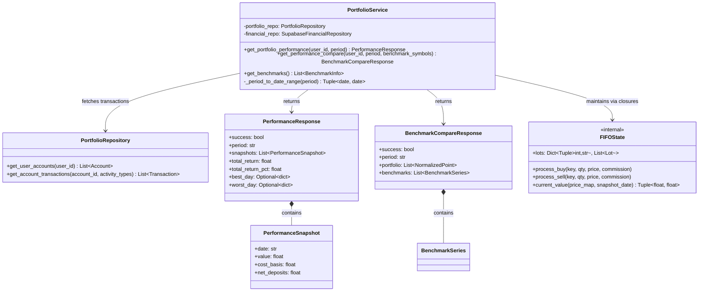

# Portfolio Module Design

## Table of Contents

1. [System Architecture](#1-system-architecture)
2. [Database Schema](#2-database-schema)
3. [Wealthsimple CSV Upload Flow](#3-wealthsimple-csv-upload-flow)
4. [Manual Transaction Flow](#4-manual-transaction-flow)
5. [FIFO Holdings Calculation](#5-fifo-holdings-calculation)
6. [Dividend Extraction](#6-dividend-extraction)
7. [Display & API Layer](#7-display--api-layer)
8. [Adding a New Brokerage](#8-adding-a-new-brokerage)
9. [API Endpoint Reference](#9-api-endpoint-reference)
10. [Troubleshooting](#10-troubleshooting)
11. [File Map & Overview](#11-file-map--overview)
12. [UI Redesign — Performance Chart, Benchmark Comparison & Holdings Enhancement](#12-ui-redesign--performance-chart-benchmark-comparison--holdings-enhancement)
13. [Portfolio Performance — Implementation Details](#13-portfolio-performance--implementation-details)

---

## 1. System Architecture

```
┌─────────────────────────────────────────────────────────────────────┐
│                      FRONTEND (Next.js + React)                     │
│  Upload CSV  │  Manual Form  │  View Holdings  │  Portfolio Overview │
│   │          │               │                  │                    │
│   │ POST     │ POST          │ GET              │ GET                │
│   │ /import  │ /transactions/│ /holdings        │ /overview          │
│   │          │ manual        │                  │                    │
│   ▼          ▼               ▼                  ▼                    │
│  ┌────────────────────────────────────────────────────────────────┐ │
│  │  React Query                                                  │ │
│  │  useImportTransactions() → returns import_batch_id            │ │
│  │  useImportStatus(batchId) → polls every 2s until done         │ │
│  └────────────────────────────────────────────────────────────────┘ │
└──────────┬──────────────────────────────────────────────────────────┘
            │ POST /import      │ GET /import/{import_batch_id}/status
           ▼                   ▼
┌─────────────────────────────────────────────────────────────────────┐
│                        API LAYER (api/portfolio.py)                 │
│  Router: /portfolio/*                                                │
│  Auth: Firebase → resolves to internal user_id                      │
│  Rate limited (5/min import, 30/min status, 30/min reads)          │
└──────┬───────────────────────────────────────┬──────────────────────┘
       │                                       │
       ▼                                       ▼
┌──────────────────────────────────────┐  ┌──────────────────────────┐
│     SERVICE LAYER (services/)        │  │ BACKGROUND WORKER        │
│  PortfolioService                    │  │ (in-process asyncio task)│
│  ┌────────────────────────────────┐  │  │                          │
│  │ queue_import() - validates,    │  │  │ asyncio.create_task()    │
│  │   creates pending job, kicks   │──┼──┤ _process_import_         │
│  │   off background task          │  │  │   background()           │
│  │                                │  │  │  • Parse CSV             │
│  │ add_manual_transaction()       │  │  │  • Create accounts       │
│  │ _recalculate_account_holdings() │  │  │  • Company lookup        │
│  │ _calculate_symbol_holding_fifo()│  │  │  • Insert transactions  │
│  │ _ensure_companies_exist_with_  │  │  │  • Recalc holdings       │
│  │   tracking()                   │  │  │  • Extract dividends      │
│  │ _create_company_from_symbol()  │  │  │                          │
│  └────────────────────────────────┘  │  └──────────────────────────┘
└──────┬──────────────────────────┬─────┘              │
       │                          │                   │
       ▼                          ▼                   ▼
┌─────────────────┐    ┌──────────────────────────────────────────────┐
│  PARSER LAYER   │    │            REPOSITORY LAYER                  │
│  (application/  │    │  (infrastructure/repositories/)              │
│   parsers/)     │    │                                              │
│                 │    │  PortfolioRepository:                        │
│  get_parser()───│───►│  - get_or_create_account()                   │
│  (factory fn)   │    │  - insert_transactions_with_duplicates()    │
│                 │    │    (uses upsert with ignore_duplicates)     │
│  Wealthsimple   │    │  - create_import_job()                      │
│  Parser         │    │  - update_import_progress()                 │
│  (active)       │    │  - get_import_job()                          │
│                 │    │  - get_account_holdings()                    │
│  IBKRParser     │    │  - upsert_holding()                          │
│  (extensible)   │    │  - insert_dividends()                        │
│                 │    └──────────┬───────────────────────────────────┘
│  Questrade      │               │
│  Parser         │               ▼
│  (extensible)   │    ┌──────────────────┐
└─────────────────┘    │    SUPABASE      │
                       │  (PostgreSQL)    │
                       └──────────────────┘
```

### Layer Responsibilities

| Layer | Responsibility | Technology |
|-------|---------------|------------|
| **API** | HTTP routing, auth, rate limiting, request/response validation | FastAPI, Pydantic |
| **Service** | Business logic, orchestration, error handling | Python |
| **Parser** | CSV format handling, symbol normalization, per-brokerage logic | Python (Strategy pattern) |
| **Repository** | Pure data access, Supabase queries, no business logic | Python |
| **Database** | Persistence, constraints, views | Supabase (PostgreSQL) |

---

## 2. Database Schema

### `portfolio_brokerages`

Registered brokerage types.

```sql
CREATE TABLE public.portfolio_brokerages (
  brokerage_id   INTEGER PRIMARY KEY,
  brokerage_code VARCHAR NOT NULL UNIQUE,  -- 'wealthsimple', 'ibkr', 'questrade'
  brokerage_name VARCHAR NOT NULL,         -- 'Wealthsimple', 'Interactive Brokers'
  country_code   VARCHAR NOT NULL DEFAULT 'CA',
  is_active      BOOLEAN NOT NULL DEFAULT true,
  parser_class   VARCHAR,                  -- reserved: Python parser class name
  created_at     TIMESTAMPTZ NOT NULL DEFAULT now()
);
```

### `portfolio_accounts`

User's accounts at each brokerage.

```sql
CREATE TABLE public.portfolio_accounts (
  account_id          BIGINT PRIMARY KEY,
  user_id             INTEGER NOT NULL REFERENCES users(user_id),
  brokerage_id        INTEGER NOT NULL REFERENCES portfolio_brokerages(brokerage_id),
  account_external_id VARCHAR NOT NULL,      -- brokerage-side account number
  account_name        VARCHAR NOT NULL,      -- display name
  account_type        VARCHAR NOT NULL,      -- 'TFSA', 'RRSP', 'Non-registered', 'IRA', etc.
  currency            VARCHAR NOT NULL DEFAULT 'CAD',
  is_active           BOOLEAN NOT NULL DEFAULT true,
  created_at          TIMESTAMPTZ NOT NULL DEFAULT now(),
  updated_at          TIMESTAMPTZ NOT NULL DEFAULT now(),
  last_import_at      TIMESTAMPTZ,

  UNIQUE (user_id, brokerage_id, account_external_id)
);
```

> **Note:** This table has **two** FK constraints on `brokerage_id`:
> - `portfolio_accounts_brokerage_id_fkey`
> - `fk_portfolio_accounts_brokerage`
>
> Supabase/PostgREST requires the `!fk_portfolio_accounts_brokerage` hint in embeds to disambiguate.

### `portfolio_transactions`

Every trade, dividend, cash movement, etc. This is the **append-only source of truth** — all holdings and dividends are derived from this table.

```sql
CREATE TABLE public.portfolio_transactions (
  transaction_id   BIGINT PRIMARY KEY,
  account_id       BIGINT NOT NULL REFERENCES portfolio_accounts(account_id),
  company_id       INTEGER REFERENCES companies(company_id),
  transaction_date DATE NOT NULL,
  settlement_date  DATE,
  activity_type    VARCHAR NOT NULL,      -- 'Trade', 'Dividend', 'MoneyMovement', 'CorporateAction'
  activity_sub_type VARCHAR,              -- 'BUY', 'SELL', 'DIV', 'EFT', 'SPLIT'
  direction        VARCHAR,               -- 'LONG', 'SHORT'
  symbol           VARCHAR,               -- Normalized ticker (after CDR/dot processing)
  security_name    TEXT,
  currency         VARCHAR NOT NULL DEFAULT 'CAD',
  quantity         NUMERIC,               -- + for buys, - for sells (Wealthsimple convention)
  unit_price       NUMERIC,               -- Per-share price
  commission       NUMERIC DEFAULT 0,
  net_cash_amount  NUMERIC,               -- Total cash impact: - for money leaving, + for money entering
  import_batch_id  UUID,                  -- Links to portfolio_import_history.import_batch_id
  raw_data         JSONB,                 -- Original CSV row for debugging / data recovery
  entry_source     VARCHAR NOT NULL DEFAULT 'csv_import',  -- 'csv_import' or 'manual_entry'
  created_by_user_id INTEGER REFERENCES users(user_id),
  created_at       TIMESTAMPTZ NOT NULL DEFAULT now(),

  CONSTRAINT unique_transaction_fingerprint UNIQUE (account_id, transaction_date, symbol, quantity, net_cash_amount)
);
```

**Key Fields:**
- `import_batch_id` — foreign key to `portfolio_import_history.import_batch_id`. Enables tracing every imported row back to its source CSV.
- `raw_data` — stores the full original CSV row as JSONB. Used for debugging parse issues and potential data recovery. Not queried in normal operation.
- `entry_source` — distinguishes between bulk CSV imports (`'csv_import'`) and single manual entries (`'manual_entry'`).
- `net_cash_amount` — the net monetary impact. Negative for money leaving (BUY, WITHDRAWAL), positive for money entering (SELL, DIVIDEND, DEPOSIT). This is the primary financial metric.
- `unique_transaction_fingerprint` — composite unique constraint on `(account_id, transaction_date, activity_type, symbol, quantity, net_cash_amount)`. Used by `insert_transactions_with_duplicates()` with `ON CONFLICT DO NOTHING` for duplicate row skipping.

### `portfolio_holdings`

Current positions calculated via FIFO. **Fully recomputed** on every import/manual entry — never updated incrementally. This is a derived view of `portfolio_transactions`.

```sql
CREATE TABLE public.portfolio_holdings (
  holding_id               BIGINT PRIMARY KEY,
  account_id               BIGINT NOT NULL REFERENCES portfolio_accounts(account_id),
  company_id               INTEGER NOT NULL REFERENCES companies(company_id),
  symbol                   VARCHAR NOT NULL,
  quantity                 NUMERIC NOT NULL,         -- Current shares held (always positive)
  average_cost             NUMERIC NOT NULL,         -- Weighted average cost per share (FIFO)
  total_cost               NUMERIC NOT NULL,         -- Total cost basis = quantity * average_cost
  current_price            NUMERIC,                  -- Latest market price (from current_market_data)
  current_value            NUMERIC,                  -- quantity * current_price
  unrealized_gain_loss     NUMERIC,                  -- current_value - total_cost
  unrealized_gain_loss_pct NUMERIC,                  -- (current_value - total_cost) / total_cost * 100
  realized_gain_loss       NUMERIC DEFAULT 0,        -- Cumulative realized P&L from closed lots
  currency                 VARCHAR NOT NULL DEFAULT 'CAD',
  first_purchase_date      DATE,                     -- Earliest BUY transaction date
  last_transaction_date    DATE,                     -- Most recent transaction date
  computed_at              TIMESTAMPTZ NOT NULL DEFAULT now(),  -- When this row was computed
  updated_at               TIMESTAMPTZ NOT NULL DEFAULT now(),

  UNIQUE (account_id, company_id)                    -- One row per (account, symbol)
);
```

### `portfolio_dividends`

Extracted from transactions for dividend-specific analytics. Each row corresponds to one dividend payment from one transaction row.

```sql
CREATE TABLE public.portfolio_dividends (
  dividend_id   BIGINT PRIMARY KEY,
  account_id    BIGINT NOT NULL REFERENCES portfolio_accounts(account_id),
  company_id    INTEGER REFERENCES companies(company_id),
  transaction_id BIGINT REFERENCES portfolio_transactions(transaction_id),  -- Source transaction for audit trail
  symbol        VARCHAR NOT NULL,
  payment_date  DATE NOT NULL,                    -- Same as transaction_date from source
  amount        NUMERIC NOT NULL,                 -- Always positive (|net_cash_amount|)
  currency      VARCHAR NOT NULL DEFAULT 'CAD',
  fiscal_year   INTEGER NOT NULL,                 -- year(payment_date), pre-computed for easy aggregation
  fiscal_month  INTEGER NOT NULL CHECK (fiscal_month >= 1 AND fiscal_month <= 12),  -- month(payment_date)
  created_at    TIMESTAMPTZ NOT NULL DEFAULT now()
);
```

### `portfolio_import_history`

Tracks every CSV import for duplicate detection, auditing, and async progress tracking. Acts as a **job queue** with a state machine lifecycle.

```sql
CREATE TABLE public.portfolio_import_history (
  import_id        BIGINT PRIMARY KEY,
  user_id          INTEGER NOT NULL REFERENCES users(user_id),
  brokerage_id     INTEGER NOT NULL REFERENCES portfolio_brokerages(brokerage_id),
  import_batch_id  UUID NOT NULL UNIQUE,     -- Generated by server, returned to frontend for polling
  csv_hash         VARCHAR NOT NULL,          -- SHA-256 of raw CSV content (for duplicate detection)
  csv_filename     VARCHAR,                   -- Original filename (informational)
  csv_size_bytes   BIGINT,                    -- Size in bytes (informational)
  total_rows       INTEGER NOT NULL DEFAULT 0,  -- Total CSV rows (set at queue time after parse)
  rows_parsed      INTEGER NOT NULL DEFAULT 0,  -- Incremented during parse phase (for progress bar)
  imported_rows    INTEGER NOT NULL DEFAULT 0,  -- Final count after duplicate filtering (mapped to rows_inserted in API response)
  duplicate_rows   INTEGER DEFAULT 0,           -- Count of rows skipped due to UNIQUE constraint
  error_rows       INTEGER DEFAULT 0,           -- Count of rows that failed to parse
  account_filter   JSONB,                       -- User's account type filter (e.g. ["TFSA","RRSP"])
  accounts_created INTEGER DEFAULT 0,
  accounts_updated INTEGER DEFAULT 0,
  symbols_created  INTEGER DEFAULT 0,
  status           VARCHAR NOT NULL DEFAULT 'pending',  -- 'pending' | 'processing' | 'completed' | 'failed'
  error_message    TEXT,
  created_at       TIMESTAMPTZ NOT NULL DEFAULT now(),
  started_at       TIMESTAMPTZ,                 -- Auto-set when status changes to 'processing'
  completed_at     TIMESTAMPTZ                  -- Auto-set when status changes to 'completed' or 'failed'
);
```

**State Machine:**
```
queue_import()
  → status='pending'      (row created, no timing columns set)
  → status='processing'   (started_at auto-set to now())
  → status='completed'    (completed_at auto-set; all counters filled)
  → status='failed'       (completed_at auto-set; error_message filled)
```

**Key Fields:**
- `import_batch_id` — generated as a UUID v4 by the server. Returned to the frontend in the POST response, used as the polling key for `GET /portfolio/import/{import_batch_id}/status`.
- `csv_hash` — SHA-256 hex digest of the raw CSV content string (before base64 decoding). Used by `check_duplicate_import()` to reject re-uploads of identical files.
- `rows_parsed` vs `imported_rows`: `rows_parsed` is updated during CSV parsing for progress bar display; `imported_rows` is the final count after account/company resolution and duplicate filtering.
- `started_at` / `completed_at` — auto-managed by `update_import_progress()` based on status transitions. No manual timestamp setting needed.
- `error_message` — set on failure. Displayed in the UI toast.

---

## 3. Wealthsimple CSV Upload Flow (Async)

### 3.1 Entry Point

```
POST /portfolio/import
```

**Request body:**

```json
{
  "brokerage_code": "wealthsimple",
  "csv_content": "<base64-encoded CSV>",
  "account_filter": ["TFSA", "RRSP"]
}
```

**Immediate response (200 OK):**

```json
{
  "success": true,
  "import_batch_id": "uuid-here",
  "status": "pending",
  "total_rows": 2798,
  "account_types": {"TFSA": 1500, "Non-registered": 1298},
  "warnings": []
}
```

### 3.2 Polling Endpoint

```
GET /portfolio/import/{import_batch_id}/status
```

**Response while processing:**

```json
{
  "success": true,
  "import_batch_id": "uuid-here",
  "status": "processing",
  "total_rows": 2798,
  "rows_parsed": 1450,
  "error": null
}
```

**Response when complete:**

```json
{
  "success": true,
  "import_batch_id": "uuid-here",
  "status": "completed",
  "total_rows": 2798,
  "rows_parsed": 2798,
  "rows_inserted": 2734,
  "result": {
    "accounts_created": 2,
    "accounts_updated": 3,
    "transactions_imported": 2734,
    "transactions_duplicate": 64,
    "holdings_updated": 5,
    "dividends_extracted": 2008,
    "symbols_created": 5,
    "symbols_missing": [],
    "account_types": {"TFSA": 1500, "Non-registered": 1298}
  },
  "error": null
}
```

### 3.3 Complete Step-by-Step

#### Step A: Auth & Queue (`api/portfolio.py`)

1. Firebase auth token → resolve `auth_id` → internal `user_id` via `users` table
2. Base64-decode CSV content
3. Validate CSV is not empty
4. Call `service.queue_import()` which:
   - Validates brokerage exists
   - SHA-256 hash → duplicate check against `portfolio_import_history`
   - Creates a new import job row with `status='pending'`
   - Wraps pre-checks in try/except (failures update the job record)
   - Launches `asyncio.create_task(_process_import_background(...))`
    - Returns immediately with `ImportQueueResult(import_batch_id, status)`

#### Step B: Background Processing (`_process_import_background`)

Runs asynchronously after the HTTP response is sent. Updates job status throughout:

```
1. Update status → 'processing'
2. Parse CSV (Step C)
3. Resolve accounts (Step D)
4. Resolve companies (Step E)
5. Insert transactions (Step F)
6. Recalculate holdings (Step G)
7. Extract dividends (Step H)
8. Update status → 'completed' (or 'failed')

Each step updates `rows_parsed` and other counters via `update_import_progress()`.

#### Step C: CSV Parsing

```
get_parser("wealthsimple") → WealthsimpleParser instance
parser.parse_csv(csv_content, account_filter) → ParseResult
```

**`WealthsimpleParser.parse_csv()` algorithm:**

```
For each row from csv.DictReader:
  1. Skip if ALL columns empty
  2. Skip if transaction_date doesn't look like YYYY-MM-DD (filters footer row)
  3. Parse activity_type and account_type
  4. Skip if account_type not in user's filter
  5. Skip corporate actions (no net_cash_amount):
     If activity_type in {LegacyCorporateAction, CorporateAction, Split, StockDividend}
     → warning "Corporate action skipped" → continue (no error, no call to _parse_row)
  6. Call _parse_row():
     a. Parse transaction_date (%Y-%m-%d format)
     b. Validate required: account_id, account_type, activity_type
     c. Parse optional: symbol, name, quantity, price, commission
     d. Normalize symbol:
        - Uppercase, trim
        - Remove CDR suffixes: "TSLA CDR (CAD Hedged)" → "TSLA"
        - Convert dots: "BBD.A" → "BBD-A"
     e. Parse net_cash_amount (required — always present for non-corp-action rows)
     f. Return ParsedTransaction
```

**CSV format:**

```
transaction_date,settlement_date,account_id,account_type,activity_type,
activity_sub_type,direction,symbol,name,currency,quantity,unit_price,
commission,net_cash_amount
```

**Footer row (skipped):**

```
As of 2026-05-10 13:55 GMT-04:00,,,,,,,,,,,,,
```

**Wealthsimple activity types encountered:**

| Type | Sub-type | Count in sample (2798 rows) | Has net_cash? |
|------|----------|---------------------------|--------------|
| Dividend | (empty) | 2008 | Yes |
| Trade | BUY | 256 | Yes |
| Trade | SELL | 49 | Yes |
| InternalSecurityTransfer | (empty) | 134 | Yes |
| MoneyMovement | EFT | 102 | Yes |
| Interest | (empty) | 74 | Yes |
| FxExchange | (empty) | 42 | Yes |
| ReturnOfCapital | (empty) | 27 | Yes |
| MoneyMovement | TRANSFER_TF | 20 | Yes |
| MoneyMovement | TRANSFER | 17 | Yes |
| Tax | (empty) | 2 | Yes |
| BonusPayment | AFFILIATE | 2 | Yes |
| NonCashDistribution | (empty) | 1 | Yes |
| LegacyCorporateAction | NAME_CHANGE (40), SPLIT (1) | 41 | **No** |
| CorporateAction | MERGER, SUBDIVISION, CONSOLIDATION, etc. | 21 | **No** |
| StockDividend | (empty) | 1 | **No** |

#### Step D: Account Resolution

```
For each unique account_external_id:
  get_or_create_account(user_id, brokerage_id, external_id, name, type, currency)
    → SELECT by (user_id, brokerage_id, account_external_id)
    → If exists: return existing
    → If not: INSERT into portfolio_accounts
    → Return account_id
```

#### Step E: Company Resolution

```
Collect all unique symbols:

Batch-check companies table (one SELECT with .in_()):

For each missing symbol → _create_company_from_symbol():
  1. asyncio.sleep(0.5) between calls ← rate-limit avoids YFinance throttling
  2. stock_provider.get_stock_details(symbol)
  3. If None → retry with Canadian suffixes ".TO", ".V"
  4. If still None → INSERT minimal record:
       {ticker_symbol, company_name=symbol, exchange="UNKNOWN"}
     This ensures holdings can still reference a company_id when the
     provider has no data (e.g. delisted symbols, network outages).
  5. If provider returned data → INSERT full record:
       {ticker_symbol, company_name, exchange, sector, industry, currency}
     NOTE: market_cap and full_time_employees are NOT part of the
     StockDetails model — accessing them caused silent AttributeError
     crashes that prevented all company creation. Removed.
  6. Map symbol → company_id
```

#### Step F: Transaction Insertion

```
Convert each ParsedTransaction → DB dict:
  {account_id, company_id, transaction_date, settlement_date,
   activity_type, activity_sub_type, direction, symbol,
   security_name, currency, quantity, unit_price,
   commission, net_cash_amount, raw_data, entry_source}

insert_transactions_with_duplicates(ignore_duplicates=True):
  → One UPSERT per row
   → ON CONFLICT (account_id, transaction_date, activity_type, symbol, quantity, net_cash_amount)
    DO NOTHING → counted as duplicate
  → Returns (imported_count, duplicate_count)
```

See [Section 3.4](#34-duplicate-insertion-strategy) for detailed comparison.

#### Step G: Holdings Recalculation

```
For each affected account:
  → _recalculate_account_holdings(account_id)
    1. Get ALL "Trade" transactions, ordered by date
    2. Group by symbol
    3. For each symbol → _calculate_symbol_holding_fifo()
    4. DELETE old holdings for account
    5. UPSERT new holdings with current prices
```

See [Section 5](#5-fifo-holdings-calculation) for the FIFO algorithm.

#### Step H: Dividend Extraction

```
Scan ALL transactions (not just "Trade"):
  If activity_type.upper() == "DIVIDEND"
  Or activity_sub_type in ("DIV", "DIST", "DIVIDEND"):
    → Create portfolio_dividends record:
      {account_id, company_id, transaction_id, symbol,
       payment_date, amount(net_cash), currency,
       fiscal_year, fiscal_month}
    → INSERT into portfolio_dividends
```

#### Step I: Import History Finalization

```
Update import job row:
  status = 'completed' (or 'failed')
  total_rows, imported_rows (stored in rows_inserted response), duplicate_rows
  rows_parsed, accounts_created, accounts_updated, symbols_created
  completed_at = now()
```

### 3.4 Duplicate Insertion Strategy

| Approach | Description | Status |
|----------|------------|--------|
| **Bulk UPSERT** *(current)* | `supabase.table().upsert(transactions, ignore_duplicates=True, on_conflict="account_id,transaction_date,activity_type,symbol,quantity,net_cash_amount")` — INSERT ... ON CONFLICT DO NOTHING in one batch | Implemented |
| Single-row UPSERT | One UPSERT per row, counts duplicates via `len(data) - len(inserted)` | Replaced |
| One-by-one with exception catching | Try INSERT, catch unique violation per row | Discarded |
| Pre-check SELECT | SELECT fingerprint before each INSERT | Discarded |

---

## 4. Manual Transaction Flow

### 4.1 Entry Point

```
POST /portfolio/transactions/manual
```

**Request body:**

```json
{
  "account_id": 123,
  "transaction_date": "2024-06-15",
  "activity_type": "BUY",
  "symbol": "AAPL",
  "quantity": 10,
  "unit_price": 150.00,
  "commission": 4.95,
  "notes": "Bought the dip"
}
```

### 4.2 Supported Activity Types

| Type | Requires symbol | Net cash formula |
|------|----------------|------------------|
| BUY | Yes | `-(qty × price + commission)` (money leaves) |
| SELL | Yes | `qty × price - commission` (money enters) |
| DIVIDEND | No | `qty` (qty field holds amount) |
| DEPOSIT | No | `qty` (positive) |
| WITHDRAWAL | No | `-qty` (negative) |

### 4.3 Step-by-Step

1. **Auth & Ownership**: Verify `account.user_id == current_user`
2. **Validate fields**: Symbol required for BUY/SELL; qty+price required for BUY/SELL
3. **Company resolution**: Get/create company from symbol (same as CSV flow)
4. **Net cash calculation** (see table above)
5. **Insert** into `portfolio_transactions`
6. **Recalculate holdings** for that account (same FIFO as CSV)
7. **Extract dividend** if `activity_type == "DIVIDEND"`
8. **Return** `{transaction_id, company_created: bool, company_name: Optional[str], transaction: {...}}`

### 4.4 Key Differences from CSV Import

| Aspect | CSV Import | Manual Entry |
|--------|-----------|--------------|
| Data source | Bulk file | Single form |
| Rate limit | 5/minute | 30/minute |
| Account mapping | Auto-create from `account_external_id` | Must select existing account |
| Company lookup | Batch + auto-create | Single + auto-create |
| Holdings calc | Batch all accounts | Single account |
| Duplicate detection | SHA-256 hash of entire CSV | Not applicable |
| Error handling | Skip bad rows, continue | Fail + rollback single tx |

---

## 5. FIFO Holdings Calculation

### 5.1 Algorithm

Implemented in `portfolio_service.py:_calculate_symbol_holding_fifo()`:

```
Input: transactions sorted by date ASC (for one symbol in one account)

lots = []           // queue of purchase lots
total_quantity = 0
total_cost = 0
realized_gain_loss = 0
first_purchase_date = None

For each transaction:
  quantity = Decimal(str(tx.quantity))
  price = Decimal(str(tx.unit_price))
  commission = Decimal(str(tx.commission))

  # NOTE: activity_sub_type is uppercased with .upper() in the actual
  # implementation to handle case variation in CSV data. The design-doc
  # pseudocode shows the raw comparison for readability only.
  activity_sub = (tx.activity_sub_type or "").upper()

  if activity_sub == "BUY":
    cost_per_share = price + (commission / quantity)
    lots.push({quantity, cost_per_share, date})
    total_quantity += quantity
    total_cost += quantity * cost_per_share
    if first_purchase_date is None:
      first_purchase_date = date

  elif activity_sub_type == "SELL":
    sell_qty = abs(quantity)              // ← CSV stores sells as negative
    sale_proceeds = sell_qty * price - commission
    cost_of_sold = 0
    remaining = sell_qty

    while remaining > 0 and lots not empty:
      lot = lots[0]                       // oldest lot first

      if lot.quantity <= remaining:       // sell entire lot
        cost_of_sold += lot.quantity * lot.cost_per_share
        remaining -= lot.quantity
        lots.pop(0)
      else:                                // partial lot
        cost_of_sold += remaining * lot.cost_per_share
        lot.quantity -= remaining
        remaining = 0

    realized_gain_loss += sale_proceeds - cost_of_sold
    total_quantity -= sell_qty
    total_cost -= cost_of_sold

if total_quantity <= 0:
  return None  // position closed

return {
  quantity: float(total_quantity),
  average_cost: float(total_cost / total_quantity),
  total_cost: float(total_cost),
  realized_gain_loss: float(realized_gain_loss),
  first_purchase_date,
  last_transaction_date,
}
```

### 5.2 Example

```
Transactions:
  Date       | Type | Qty | Price | Commission
  -----------|------|-----|-------|-----------
  2024-01-01 | BUY  | 10  | $100  | $5
  2024-02-01 | BUY  | 5   | $110  | $5
  2024-03-01 | SELL | -3  | $120  | $0

FIFO execution:
  BUY 10 @ $100.50 → lots=[{qty:10, cost:100.50}], total_qty=10, total_cost=1005
  BUY  5 @ $111.00 → lots=[{qty:10, cost:100.50}, {qty:5, cost:111.00}], total_qty=15, total_cost=1560
  SELL 3:
    sell_qty=3, proceeds=3*120=360
    Take from lot 1: 3 of 10 → cost_of_sold=3*100.50=301.50, lot 1 remaining=7
    realized_gl=360-301.50=58.50
    total_qty=15-3=12, total_cost=1560-301.50=1258.50

Result:
  lots=[{qty:7, cost:100.50}, {qty:5, cost:111.00}]
  total_qty=12, total_cost=1258.50
  avg_cost=1258.50/12=104.875
```

### 5.3 Why `abs(quantity)` for SELLs

Wealthsimple CSV exports sell quantities as **negative** numbers (e.g., `-3`). The FIFO algorithm was originally written expecting positive quantities for both BUY and SELL. The sell branch uses `remaining_to_sell > 0` as its loop condition, which was `False` for negative values — causing sells to be silently skipped.

The fix normalizes to a positive magnitude when the activity direction (`SELL`) is already known:

```python
elif activity_sub == "SELL":
    sell_qty = abs(quantity)       # normalize once
    remaining_to_sell = sell_qty
    sale_proceeds = sell_qty * price - commission
    ...
    total_quantity -= sell_qty
```

---

## 6. Dividend Extraction

Dividends arrive via CSV as rows with `activity_type = "Dividend"` and a positive `net_cash_amount`. The extraction runs after every import:

```
_extract_dividends(account_ids):
  For each account:
    Get ALL transactions (not just "Trade")
    For each transaction:
      If activity_type.upper() == "DIVIDEND"
      Or activity_sub_type in ("DIV", "DIST", "DIVIDEND"):
        If net_cash_amount > 0:
          Create portfolio_dividends record
          INSERT into portfolio_dividends table
```

Dividends are stored in a separate table for:
- **Annual aggregation**: `SELECT SUM(amount) WHERE fiscal_year = ?`
- **Monthly summaries**: `portfolio_monthly_dividends` view
- **No re-scanning**: Historical dividends are queryable without re-parsing transactions

---

## 7. Display & API Layer

### 7.1 Portfolio Overview

```
GET /portfolio/overview

→ service.get_user_portfolio_overview(user_id)

1. Get all accounts (portfolio_accounts)
2. Get all holdings (portfolio_holdings JOIN companies)
3. Calculate totals:
   total_value = ∑ holding.current_value
   total_cost = ∑ holding.total_cost
   total_gain_loss = total_value - total_cost
4. Get YTD dividends per account
5. Sort top 10 holdings by current_value
6. Build per-account breakdown

Returns:
{
  "net_worth": float,
  "total_cost_basis": float,
  "total_gain_loss": float,
  "total_gain_loss_pct": float,
  "ytd_dividends": float,
  "total_holdings_count": int,
  "accounts_count": int,
  "top_holdings": [HoldingInfo, ...],
  "account_breakdown": [AccountBreakdown, ...]
}
```

### 7.2 Holdings

```
GET /portfolio/holdings                     → all accounts aggregated
GET /portfolio/accounts/{id}/holdings       → single account

Returns (per holding):
  {symbol, company_name, quantity, average_cost, total_cost,
   current_price, current_value, unrealized_gain_loss,
   unrealized_gain_loss_pct, realized_gain_loss}
```

### 7.3 Data Flow for Display

```
User opens portfolio page
  → GET /portfolio/overview
    → service calls:
      1. repo.get_user_accounts()           → portfolio_accounts
         (uses !fk hint for brokerage join)
      2. repo.get_user_all_holdings()       → portfolio_holdings
         (JOIN companies, portfolio_accounts)
      3. repo.get_account_dividends_by_year()→ portfolio_dividends
    → Calculate derived values
    → Return JSON response
  → Frontend renders:
    - Net worth card
    - Gain/loss card
    - YTD dividends card
    - Top holdings table
    - Account breakdown list
```

### 7.4 Response Schemas

```python
class HoldingInfo(BaseModel):
    holding_id: int
    symbol: str
    company_name: str
    sector: Optional[str]
    industry: Optional[str]
    quantity: float
    average_cost: float
    total_cost: float
    current_price: Optional[float]
    current_value: Optional[float]
    unrealized_gain_loss: Optional[float]
    unrealized_gain_loss_pct: Optional[float]
    realized_gain_loss: float
    account_name: Optional[str]
    account_type: Optional[str]

class AccountBreakdown(BaseModel):
    account_id: int
    account_name: str
    account_type: str
    brokerage_name: Optional[str]
    holdings_count: int
    total_value: float
    total_cost: float
    gain_loss: float
    gain_loss_pct: float

class PortfolioOverviewResponse(BaseModel):
    success: bool
    net_worth: float
    total_cost_basis: float
    total_gain_loss: float
    total_gain_loss_pct: float
    ytd_dividends: float
    total_holdings_count: int
    accounts_count: int
    top_holdings: List[Dict[str, Any]]
    account_breakdown: List[AccountBreakdown]
    error: Optional[str] = None
```

---

## 8. Adding a New Brokerage

### 8.1 What's Required

To add a new brokerage (e.g., Interactive Brokers), four things are needed:

#### A. CSV Parser Class

Create a parser extending `PortfolioParserBase` (stub not yet implemented; only `WealthsimpleParser` exists):

```python
# backend/application/parsers/portfolio_parser.py

class IBKRParser(PortfolioParserBase):
    SUPPORTED_ACCOUNT_TYPES = ["401k", "IRA", "Roth IRA", "MARGIN", "INDIVIDUAL"]

    # TODO: implement parse_csv() — IBKR CSV is multi-section
    # (Trades, Dividends, Corporate Actions, Interest)
    # with different columns per section.

    # TODO: implement normalize_symbol() — strip exchange suffixes
    # like "(NASDAQ)", "(ARCA)" from ticker symbols.
```

#### B. Register in Factory

```python
# In get_parser() at portfolio_parser.py:

def get_parser(brokerage_code: str) -> PortfolioParserBase:
    parsers = {
        "wealthsimple": WealthsimpleParser,
        # "ibkr": IBKRParser,         # Stub exists, not yet active
        # "questrade": QuestradeParser,  # Not yet implemented
    }
    parser_class = parsers.get(brokerage_code.lower())
    if not parser_class:
        raise ValueError(...)
    return parser_class()
```

#### C. Database Record

```sql
INSERT INTO portfolio_brokerages
    (brokerage_code, brokerage_name, country_code, is_active)
VALUES
    ('ibkr', 'Interactive Brokers', 'US', true);
```

#### D. Frontend Integration

```typescript
// types/portfolio.types.ts
export const ACCOUNT_TYPE_LABELS: Record<string, string> = {
  'TFSA': 'TFSA (Tax-Free Savings Account)',
  'RRSP': 'RRSP (Registered Retirement Savings Plan)',
  'Non-registered': 'Non-Registered',
  'FHSA': 'FHSA (First Home Savings Account)',
  '401k': '401(k)',
  'IRA': 'IRA (Individual Retirement Account)',
  'Roth IRA': 'Roth IRA',
};
```

### 8.2 The Parser Contract

Every parser returns `ParsedTransaction` objects. The service layer is agnostic to the source:

```python
@dataclass
class ParsedTransaction:
    transaction_date: date               # Valid parsed date
    settlement_date: Optional[date]
    account_external_id: str             # Brokerage-specific account number
    account_type: str                    # TFSA, MARGIN, IRA, etc.
    activity_type: str                   # Trade, Dividend, MoneyMovement, etc.
    activity_sub_type: Optional[str]     # BUY, SELL, DIV, etc.
    direction: Optional[str]             # LONG, SHORT
    symbol: Optional[str]                # Normalized ticker
    security_name: Optional[str]
    currency: str                        # ISO code
    quantity: Optional[Decimal]          # Sign: + for buys, - for sells
    unit_price: Optional[Decimal]
    commission: Decimal
    net_cash_amount: Decimal             # Sign: - for debits, + for credits
```

### 8.3 Per-Brokerage CSV Differences

| Brokerage | Date Format | Multi-currency | Account IDs | Activity Types | Complexity |
|-----------|-------------|---------------|-------------|----------------|-----------|
| **Wealthsimple** | `YYYY-MM-DD` | CAD only | `H46312403CAD` | Trade, Dividend, MoneyMovement, CorpAction | Low |
| **IBKR** | `YYYY-MM-DD, HH:MM:SS` | Yes | `U1234567` | Trades, Dividends, Withholding Tax, Interest, Corp Actions, Fees | **High** |
| **Questrade** | `YYYY-MM-DD` | CAD/USD | Account number | Trades, Deposits, Withdrawals, Dividends | Low |
| **RBC Direct** | `MM/DD/YYYY` | CAD | Account number | Trades, Dividends, Interest, Fees | Medium |
| **TD WebBroker** | `MM/DD/YYYY` | CAD | Account number | Trades, Dividends, Interest, Fees | Medium |

### 8.4 Implementation Priority

| Brokerage | Effort | Complexity | Priority | Rationale |
|-----------|--------|-----------|----------|----------|
| **Questrade** | Medium | Low | High | Canadian, clean CSV, similar to Wealthsimple |
| **IBKR** | High | High | Medium | Multi-section CSV, multi-currency, futures/options |
| **RBC Direct** | Medium | Medium | Low | Different date format, legacy |
| **TD WebBroker** | Medium | Medium | Low | Similar to RBC |

### 8.5 IBKR-Specific Challenges

1. **Multi-section CSV**: IBKR exports have labeled sections:
   ```
   Trades:
   Header,DataHeader,DataEnd
   Data,...
   DataEnd

   Dividends:
   Header,DataHeader,DataEnd
   Data,...
   DataEnd
   ```
   Each section needs different column mapping.

2. **Exchange suffixes**: Symbols include exchange: `AAPL(NASDAQ)`, `SPY(ARCA)`. Must strip suffix to match `companies.ticker_symbol`.

3. **Multi-currency**: Each trade has its own currency field. The system must handle `currency` per transaction.

4. **Withholding tax**: Dividends come with embedded withholding tax rows that need to be parsed separately.

5. **Futures/Options**: IBKR supports `/ES` futures and `AAPL 240315C00150000` options. These would need separate symbol handling (may need a `security_type` field on `ParsedTransaction`).

6. **Short sales**: IBKR supports shorting, which requires `direction = "SHORT"` handling in FIFO.

---

## 9. API Endpoint Reference

| Method | Path | Purpose | Rate Limit |
|--------|------|---------|-----------|
| `GET` | `/portfolio/brokerages` | List supported brokerages | 20/min |
| `GET` | `/portfolio/accounts` | List user's accounts with balances | 30/min |
| `DELETE` | `/portfolio/accounts/{id}` | Delete account + cascade | 10/min |
| `POST` | `/portfolio/import` | **CSV upload & import** | **5/min** |
| `GET` | `/portfolio/holdings` | Aggregated holdings (all accounts) | 30/min |
| `GET` | `/portfolio/accounts/{id}/holdings` | Per-account holdings | 30/min |
| `GET` | `/portfolio/overview` | Portfolio summary with totals | 20/min |
| `GET` | `/portfolio/accounts/{id}/transactions` | Transaction history | 30/min |
| `GET` | `/portfolio/accounts/{id}/dividends` | Dividend summary | 30/min |
| `POST` | `/portfolio/transactions/manual` | **Manual trade entry** | **30/min** |
| `GET` | `/portfolio/import/{import_batch_id}/status` | Poll import job progress | 30/min |
| `GET` | `/portfolio/performance?period=1Y&account_ids=1,3` | Portfolio value time-series (optional account filter) | 20/min |
| `GET` | `/portfolio/performance/compare?period=1Y&benchmarks=SPY&account_ids=1,3` | Portfolio vs benchmark comparison (optional account filter) | 20/min |
| `GET` | `/benchmarks` | Available benchmark indices | 20/min |
| `GET` | `/portfolio/import-history` | Past import records | 20/min |
| `GET` | `/companies/search` | Company lookup by symbol | 60/min |

---

## 10. Troubleshooting

### 10.1 Parse Flow Decision Tree

```
For each CSV row:
  ├─ ALL values empty?           → skip (line 226)
  ├─ Date not YYYY-MM-DD?        → skip (line 231, footer filter)
  ├─ Account type filtered?      → skip (line 240)
  ├─ Corporate action type?      → skip with warning (line 244-254)
  │    (LegacyCorporateAction, CorporateAction, Split, StockDividend)
  └─ _parse_row():
       ├─ transaction_date valid? → if not → error
       ├─ account_id present?     → if not → error
       ├─ account_type present?   → if not → error
       ├─ activity_type present?  → if not → error
       └─ net_cash_amount valid?  → if not → error
```

### 10.2 Common Parse Errors

| Error | Cause | Solution |
|-------|-------|----------|
| "Missing or invalid transaction_date" | Footer row "As of..." passes empty-row check | Footer filter in `parse_csv` (line 231-234) |
| "Missing or invalid net_cash_amount" | Corporate action row has no cash field | Skipped by corp action filter (line 244-254) — should NOT reach here |
| "Missing activity_type" | Completely empty row or footer | Footer filter + empty-row check |
| "Missing account_id" | Malformed or incomplete CSV row | Validate CSV before upload |

### 10.3 Known Limitations

| Limitation | Impact | Workaround |
|-----------|--------|-----------|
| Corporate actions skipped | Splits, mergers not reflected in holdings | Manual adjustment via manual transaction entry |
| Single-currency per CSV | Cannot import CAD+USD in one Wealthsimple CSV | Import separately (different brokerages/accounts) |
| FIFO only | No LIFO or specific lot selection | FIFO is hardcoded; would need `cost_basis_method` on account |
| No options/futures | Only common stock supported | Would need `security_type` field and lot tracking |
| Duplicate detection by full CSV hash | Same transactions in different CSVs not caught | Add row-fingerprint duplicate detection |
| No cost basis adjustments | ROC (Return of Capital) doesn't adjust cost basis | Would need to reduce cost basis on ROC distributions |
| ~~Provider data crash~~ **(FIXED)** | ~~`_create_company_from_symbol` accessed `sd.market_cap` and `sd.full_time_employees` which are not fields on `StockDetails` — `AttributeError` silently killed all company creation~~ | Removed the bad field accesses. Provider failure now creates a minimal company record instead of crashing. |
| ~~No Canadian suffix fallback~~ **(FIXED)** | ~~Canadian tickers (SHOP, TD, etc.) that need `.TO` or `.V` suffix for Yahoo Finance would return `None`, preventing company creation and thus holdings~~ | `_create_company_from_symbol` now retries with `.TO` / `.V` suffix before falling back to a minimal record. |
| ~~No rate limiting~~ **(FIXED)** | ~~Batch lookups of 50+ symbols during CSV import triggered Yahoo rate limiting after 5-10 rapid calls, causing all subsequent lookups to fail~~ | `asyncio.sleep(0.5)` inserted between each provider call in `_ensure_companies_exist_with_tracking`. |

### 10.4 Error Flow

```
User uploads CSV
  → POST /portfolio/import
    → Service.queue_import()
      → Validations (brokerage, empty CSV) → fail early if invalid
      → Duplicate check (SHA-256) → fail early if duplicate
      → Parse CSV (synchronous) ← note: parsed BEFORE creating the job record
        → ParseResult.success = false?
          → Return error response immediately — NO job record created
        → No transactions?
          → Return error response immediately — NO job record created
      → Create import job row with status='pending'
      → Return {import_batch_id, status: 'pending'} immediately
      → Launch background task

Background task (asyncio)
  → Update status → 'processing'
  → Create accounts, resolve companies, insert transactions
    → Exception → update job: status='failed', error_message="..."
  → Recalculate holdings (FIFO)
    → Exception → log → continue (holdings stale but data saved)
  → Extract dividends
  → Update job: status='completed'

Frontend polls:
  → GET /portfolio/import/{import_batch_id}/status
    → Returns current status, error (if failed), and result (if completed)

Key difference from earlier drafts:
  CSV parsing and the "no transactions" check happen synchronously
  inside queue_import(), BEFORE the job record is created. This means
  parse failures never create an import_job row — the frontend gets
  an immediate error response. Only the database-heavy steps (accounts,
  companies, transactions, holdings) run in the background worker.
```

### 10.4 Related Files

| File | Purpose |
|------|---------|
| `backend/api/portfolio.py` | API routes, request/response handling |
| `backend/schemas_portfolio.py` | Pydantic request/response schemas |
| `backend/application/services/portfolio_service.py` | Business logic, orchestration |
| `backend/application/parsers/portfolio_parser.py` | CSV parsers + factory |
| `backend/infrastructure/repositories/portfolio_repository.py` | Data access layer |
| `backend/database.py` | Supabase client singleton |
| `backend/scripts/fix_portfolio_weights.py` | One-off data fix for institutional_holdings (unrelated domain) |
| `web/src/app/(authenticated)/portfolio/page.tsx` | Next.js route page |
| `web/src/features/portfolio/types/portfolio.types.ts` | TypeScript interfaces + constants |
| `web/src/features/portfolio/services/portfolio.service.ts` | API client class (Axios) |
| `web/src/features/portfolio/hooks/usePortfolio.ts` | React Query hooks + polling |
| `web/src/features/portfolio/components/PortfolioOverview.tsx` | Main dashboard |
| `web/src/features/portfolio/components/PortfolioEntrySelector.tsx` | Empty-state entry point |
| `web/src/features/portfolio/components/ImportTransactionsModal.tsx` | CSV import modal with progress |
| `web/src/features/portfolio/components/ManualTradeForm.tsx` | Single-trade form |
| `web/src/shared/contexts/ServiceContext.tsx` | React context for service injection |

---

## 11. File Map & Overview

### 11.1 Backend Directory Tree

```
backend/
├── api/
│   └── portfolio.py                  FastAPI router — all /portfolio/* endpoints
├── schemas_portfolio.py              Pydantic models for every request/response
├── application/
│   ├── services/
│   │   └── portfolio_service.py      Business logic — orchestration layer
│   └── parsers/
│       └── portfolio_parser.py       CSV parsing framework + parsers
├── infrastructure/
│   └── repositories/
│       └── portfolio_repository.py   Data access layer — all Supabase queries
├── scripts/
│   └── fix_portfolio_weights.py      One-off data migration (institutional_holdings)
└── database.py                       Supabase client singleton
```

### 11.2 Backend File Contents

**`backend/api/portfolio.py`** (789 lines)
- `router = APIRouter()`  (all paths absolute like `/portfolio/...`)
- Helpers: `_get_portfolio_service()`, `_resolve_db_user_id()` (Firebase → internal user_id)
- Endpoints:
  - `GET /brokerages` — list active brokerages
  - `GET /accounts` — list user's accounts
  - `DELETE /accounts/{id}` — delete account + cascading cleanup
  - `POST /import` — queue CSV import, return import_batch_id (200 OK)
  - `GET /import/{import_batch_id}/status` — poll import progress
  - `GET /holdings` — all accounts aggregated
  - `GET /accounts/{id}/holdings` — single account holdings
  - `GET /overview` — portfolio summary with totals
  - `GET /accounts/{id}/transactions` — paginated transaction history
  - `GET /accounts/{id}/dividends` — dividend summary
  - `POST /transactions/manual` — single trade/dividend entry
  - `GET /import-history` — past import records
  - `GET /companies/search` — company lookup (uses `companies` table)

**`backend/schemas_portfolio.py`** (274 lines)
- Request models: `ImportTransactionsRequest`, `DeleteAccountRequest`, `ManualTransactionRequest`
- Response models: `ImportTransactionsResponse`, `ImportStatusResponse`, `ManualTransactionResponse`, `PortfolioOverviewResponse`, `ListBrokeragesResponse`, `ListAccountsResponse`, `AccountHoldingsResponse`, `AccountTransactionsResponse`, `AccountDividendsResponse`
- Supporting models: `BrokerageInfo`, `PortfolioAccountInfo`, `HoldingInfo`, `AccountBreakdown`, `TransactionInfo`, `DividendInfo`, `MonthlyDividendsSummary`
- Field validators: brokerage code normalization, activity type validation

**`backend/application/services/portfolio_service.py`** (1128 lines)
- `class PortfolioService` — main business logic class
- CSV import: `queue_import()` (validate + create pending job), `_process_import_background()` (async worker)
- Manual entry: `add_manual_transaction()`
- Holdings: `_recalculate_account_holdings()`, `_calculate_symbol_holding_fifo()`, `_ensure_companies_exist_with_tracking()`
- Dividends: `_extract_dividends()`
- Overview: `get_user_portfolio_overview()`
- Company: `_create_company_from_symbol()` (YFinance lookup + insert)
- Duplicate: `check_duplicate_import()` (SHA-256 hash)

**`backend/application/parsers/portfolio_parser.py`** (413 lines)
- `@dataclass ParsedTransaction` — normalized row output
- `@dataclass ParseResult` — `{success, transactions, errors, warnings, total_rows, parsed_rows, skipped_rows, account_type_summary}`
- `class PortfolioParserBase` — abstract base with CSV helpers (date parsing, decimal parsing)
- `class WealthsimpleParser(PortfolioParserBase)` — concrete parser for Wealthsimple CSVs
  - Account types: TFSA, RRSP, Non-registered, FHSA
  - Symbol normalization: CDR suffix removal, dot-to-hyphen
  - Corporate action filtering
- `def get_parser(brokerage_code)` — factory function, dispatches to correct parser (only `wealthsimple` active; `IBKRParser` and `QuestradeParser` stubs are commented out)

**`backend/infrastructure/repositories/portfolio_repository.py`** (625 lines)
- `class PortfolioRepository` — pure data access, NO business logic
- Brokerages: `get_brokerage_by_code()`, `list_active_brokerages()`
- Accounts: `get_user_accounts()`, `get_account_by_id()`, `get_or_create_account()`, `update_account_import_timestamp()`
- Transactions: `insert_transactions_with_duplicates()` (UPSERT with `ON CONFLICT DO NOTHING`), `get_account_transactions()`, `delete_account_transactions()`
- Holdings: `get_account_holdings()`, `get_user_all_holdings()`, `upsert_holding()`, `delete_account_holdings()`
- Dividends: `insert_dividends()`, `get_account_dividends_by_year()`, `get_monthly_dividends()`
- Performance: `get_account_performance_history()`, `upsert_performance_snapshot()`
- Import jobs: `create_import_job()`, `update_import_progress()`, `get_import_job()`, `get_import_history()`

### 11.3 Frontend Directory Tree

```
web/src/
├── app/(authenticated)/portfolio/
│   └── page.tsx                              Next.js route page
├── features/portfolio/
│   ├── types/
│   │   └── portfolio.types.ts                TypeScript interfaces
│   ├── services/
│   │   └── portfolio.service.ts              API client (Axios)
│   ├── hooks/
│   │   ├── usePortfolio.ts                   React Query hooks
│   │   └── useStaggeredReveal.ts             Streaming reveal animation hook
│   └── components/
│       ├── PortfolioOverview.tsx              Main dashboard
│       ├── PortfolioEntrySelector.tsx         Empty-state entry point
│       ├── ImportTransactionsModal.tsx        CSV import dialog
│       ├── ManualTradeForm.tsx                Single-trade form
│       ├── PortfolioPerformanceChart.tsx      Performance chart (recharts AreaChart)
│       ├── BenchmarkSelector.tsx              Benchmark comparison dropdown
│       ├── AccountSelector.tsx                Account filter dropdown
│       ├── TimePeriodSelector.tsx             Segmented period picker (1D–ALL)
│       └── HoldingsSection.tsx                Searchable/sortable/groupable holdings list
└── shared/contexts/
    └── ServiceContext.tsx                     Dependency injection
```

### 11.4 Frontend File Contents

**`web/src/app/(authenticated)/portfolio/page.tsx`** (31 lines)
- Checks auth (loading spinner / "not logged in")
- Renders `<PortfolioOverview />`

**`web/src/features/portfolio/types/portfolio.types.ts`** (201 lines)
- Interfaces: `Brokerage`, `PortfolioAccount`, `Holding`, `AccountBreakdown`, `PortfolioOverview`, `Transaction`, `MonthlyDividendSummary`, `ImportResult`, `ImportStatusResponse`, `AddManualTransactionRequest`, `AddManualTransactionResponse`, `ImportTransactionsRequest`
- **Note:** `AddManualTransactionResponse` in the frontend is missing `company_created` and `company_name` (backend returns them). This is a frontend type gap.
- Constants: `ACCOUNT_TYPE_LABELS`, `ACCOUNT_TYPE_COLORS` (maps for badge rendering)

**`web/src/features/portfolio/services/portfolio.service.ts`** (183 lines)
- `class PortfolioService` — wraps all portfolio endpoints via Axios
- Key methods: `importTransactions()`, `getImportStatus()`, `addManualTransaction()`, `getPortfolioOverview()`, `getAllHoldings()`, `getAccountHoldings()`, `getBrokerages()`, `getAccounts()`, `deleteAccount()`, `getAccountTransactions()`, `getAccountDividends()`
- Helper: `fileToBase64()` — converts File object to base64 for CSV upload
- Exported as singleton `portfolioService`

**`web/src/features/portfolio/hooks/usePortfolio.ts`** (192 lines)
- `usePortfolioOverview()` — standard fetch, 5 min stale time
- `usePortfolioAccounts()` — standard fetch
- `useAllHoldings()` — standard fetch
- `useAccountHoldings(accountId)` — parameterized query
- `useBrokerages()` — standard fetch
- `useImportTransactions()` — mutation, triggers toast + invalidates queries on success
- `useDeleteAccount()` — mutation with confirmation
- `useImportStatus(batchId)` — polls `GET /portfolio/import/{import_batch_id}/status` every 2s, stops when status is `completed` or `failed`
- `usePortfolioPerformance(period)` — portfolio value time-series
- `useBenchmarks()` — available benchmark indices
- `useBenchmarkCompare(period, benchmarks)` — portfolio vs benchmark comparison

**`web/src/features/portfolio/components/PortfolioOverview.tsx`** (197 lines)
- States: loading spinner, error (with import button), empty (renders `PortfolioEntrySelector`), populated (full dashboard)
- Dashboard sections:
  - Header: accounts count, positions count, "Add Trade" and "Import CSV" buttons
  - Performance chart (`PortfolioPerformanceChart`) — time-series with benchmark overlay
  - Key metrics: Net Worth, Total Gain/Loss (green/red), YTD Dividends, Holdings count
  - Account breakdown: per-account cards (name, brokerage, gain/loss, color-coded)
  - Holdings section (`HoldingsSection`) — searchable, sortable, groupable list
- Opens `ImportTransactionsModal` and `ManualTradeForm` as dialogs

**`web/src/features/portfolio/components/PortfolioEntrySelector.tsx`** (117 lines)
- Shown when user has no portfolio accounts
- Two card choices: "Upload CSV" (bulk import) or "Manual Entry" (single transaction)
- Each card shows feature list (date auto-parse, dividend extraction, FIFO calc, etc.)

**`web/src/features/portfolio/components/ImportTransactionsModal.tsx`** (353 lines)
- Brokerage dropdown (fetched from API)
- File picker (validates non-empty, checks file extension)
- Advanced: account type filter checkboxes
- Duplicate warning alert (if CSV hash matches prior import)
- Progress bar with status text (queued → processing → completed/failed)
- Success results: accounts created/updated, transactions imported, duplicates, dividends
- Uses `useImportStatus` hook for polling
- On completion: invalidates portfolio queries to refresh dashboard

**`web/src/features/portfolio/components/ManualTradeForm.tsx`** (419 lines)
- Account selector dropdown
- Activity type: BUY, SELL, DIVIDEND, DEPOSIT, WITHDRAWAL
- Date picker (defaults to today)
- Ticker symbol with debounced company check:
  - Green: "Company exists: Tesla Inc"
  - Amber: "New company will be created"
- Quantity, price, commission fields
- Notes textarea
- Auto-calculated total cost/proceeds summary
- On success: toast + query invalidation

**`web/src/shared/contexts/ServiceContext.tsx`** (28 lines)
- `ServiceProvider` wraps app, provides `PortfolioService` and `WatchlistService` singletons
- `useServices()` hook returns injected services

---

## 12. Database Table Lifecycle

### Principles

1. **Transactions are the source of truth.** All other tables (`holdings`, `dividends`) are derived and can be safely recomputed.
2. **Holdings are fully recomputed** on every mutation — never incrementally patched.
3. **Import jobs follow a state machine:** `pending → processing → completed/failed`.
4. **Duplicate detection has two levels:** CSV hash (rejects entire file) + transaction fingerprint `UNIQUE` constraint (skips individual rows).

---

### `portfolio_brokerages`

**Schema:** Section 2 above.

**Update Pattern:** Static reference data. Inserted once via database migration. Never modified by user actions.

| Operation | Triggered By | Code Path |
|-----------|-------------|-----------|
| **Insert** | Admin (manual SQL migration) | Not done via app code |
| **Read** | Brokerage lookup on import | `portfolio_repository.py:get_brokerage_by_code()` |
| **Read** | Listing active brokerages for dropdown | `portfolio_repository.py:list_active_brokerages()` |

**Consumed By:**
- `POST /portfolio/import` — validates brokerage_code and dispatches to correct parser
- `GET /portfolio/brokerages` — populates brokerage selector in `ImportTransactionsModal`

**Key Field Notes:**
- `brokerage_code` is the canonical identifier used by `get_parser()` to dispatch parsing
- `country_code` is informational only (no logic branches on it)

---

### `portfolio_accounts`

**Schema:** Section 2 above.

**Update Pattern:** Rows are created when new account IDs appear in CSV data, never created manually. Timestamp-only updates after import. Full row deletion when user removes an account.

| Operation | Triggered By | Code Path |
|-----------|-------------|-----------|
| **Insert** | CSV import — new `account_external_id` discovered | `portfolio_repository.py:get_or_create_account()` |
| **Update** | After each import — `last_import_at` timestamp refresh | `portfolio_repository.py:update_account_import_timestamp()` |
| **Delete** | User deletes account via UI | `api/portfolio.py` direct Supabase delete (cascades to transactions, holdings, dividends) |
| **Read** | Portfolio overview | `portfolio_repository.py:get_user_accounts()` |
| **Read** | Holdings display, transaction history | `portfolio_repository.py:get_account_by_id()` |

**Consumed By:**
- `GET /portfolio/overview` — lists all accounts for breakdown cards
- `GET /portfolio/accounts` — account list page
- `POST /portfolio/transactions/manual` — validates `account_id` belongs to current user
- All holdings/dividends/transactions endpoints — scoped by account

**Key Behaviors:**
- `get_or_create_account()` does SELECT-then-INSERT by `(user_id, brokerage_id, account_external_id)`. If `created_at == updated_at` after creation, it is counted as "new".
- Manual transactions require a pre-existing account (cannot auto-create).
- Deleting an account cascades to transactions, holdings, and dividends via DB foreign key constraints.

---

### `portfolio_transactions`

**Schema:** Section 2 above.

**Update Pattern:** **Append-only log.** Rows are inserted but never updated in place. Only bulk-deleted when the parent account is deleted.

| Operation | Triggered By | Code Path |
|-----------|-------------|-----------|
| **Insert** | CSV import — bulk UPSERT | `portfolio_repository.py:insert_transactions_with_duplicates()` |
| **Insert** | Manual transaction entry | `portfolio_repository.py:insert_transactions_with_duplicates()` |
| **Read** | Transaction history display | `portfolio_repository.py:get_account_transactions()` |
| **Delete** | Account deletion (cascade) | `portfolio_repository.py:delete_account_transactions()` |

**Consumed By:**
- **FIFO Holdings:** `_recalculate_account_holdings()` fetches all "Trade" transactions sorted by date
- **Dividend Extraction:** `_extract_dividends()` scans ALL transactions for dividend activity types
- **Transaction History:** `GET /portfolio/accounts/{id}/transactions` returns raw transaction list
- **Overview Metrics:** Certain aggregate values flow through holdings (not queried directly)

**Duplicate Handling (Critical Detail):**
The `unique_transaction_fingerprint` constraint spans `(account_id, transaction_date, activity_type, symbol, quantity, net_cash_amount)`. During import:
1. `insert_transactions_with_duplicates(skip_duplicates=True)` calls Supabase `.upsert(ignore_duplicates=True, on_conflict=...)`
2. `inserted_count = len(res.data)` — only truly new rows appear in the response
3. `duplicate_count = len(all_transactions) - inserted_count`
4. Duplicates are silently skipped (not errors), counted, and the import continues

**Key Fields:**
- `import_batch_id` — links every transaction back to its source CSV import for auditability
- `raw_data` — stores the original CSV row as JSONB for debugging and data recovery
- `entry_source` — `'csv_import'` or `'manual_entry'` to distinguish provenance
- `created_by_user_id` — tracks who added the transaction (especially for manual entries)

---

### `portfolio_holdings`

**Schema:** Section 2 above.

**Update Pattern:** **Fully recomputed** on every import or manual entry. Never updated incrementally.

| Operation | Triggered By | Code Path |
|-----------|-------------|-----------|
| **Write** | CSV import completion — full recalc per account | `portfolio_service.py:_recalculate_account_holdings()` |
| **Write** | Manual transaction — single account recalc | Same as above |
| **Read** | Portfolio overview aggregated | `portfolio_repository.py:get_user_all_holdings()` |
| **Read** | Per-account holdings | `portfolio_repository.py:get_account_holdings()` |

**Full Recalculation Algorithm:**
```
1. DELETE all existing holdings for the account
2. Fetch ALL "Trade" transactions, ordered by (transaction_date, transaction_id)
3. Group by symbol → for each group:
   a. Run FIFO cost-basis (_calculate_symbol_holding_fifo())
   b. If position is closed (quantity ≤ 0): return None, skip
   c. If position is open: compute current price from current_market_data
   d. Calculate: current_value, unrealized_gain_loss, unrealized_gain_loss_pct
4. UPSERT each open position
```

**Consumed By:**
- `GET /portfolio/overview` — aggregated totals, top 10 holdings, account breakdown
- `GET /portfolio/holdings` — flat list of all positions across accounts
- `GET /portfolio/accounts/{id}/holdings` — per-account position list

**Key Invariant:** Holdings are a derived view of transactions. If you delete all transactions and re-run the calc, holdings correctly reflect an empty portfolio. No state is stored outside the transaction log.

---

### `portfolio_dividends`

**Schema:** Section 2 above.

**Update Pattern:** Extracted as a post-processing step after every import. Append-only — rows are inserted but never updated. Only deleted via account cascade.

| Operation | Triggered By | Code Path |
|-----------|-------------|-----------|
| **Insert** | CSV import — dividend extraction pass | `portfolio_repository.py:insert_dividends()` |
| **Insert** | Manual dividend entry (DIVIDEND activity type) | Same as above |
| **Read** | YTD dividend summary | `portfolio_repository.py:get_account_dividends_by_year()` |
| **Read** | Monthly dividend aggregation | `portfolio_repository.py:get_monthly_dividends()` |

**Extraction Logic:**
```
Scan ALL transactions in the affected accounts (not just "Trade" type):
  If activity_type.upper() == "DIVIDEND"
  OR activity_sub_type in ("DIV", "DIST", "DIVIDEND"):
    → Create portfolio_dividends record:
      {account_id, company_id, transaction_id, symbol,
       payment_date=transaction_date, amount=|net_cash_amount|,
       currency, fiscal_year, fiscal_month}
    → INSERT into portfolio_dividends
```

**Consumed By:**
- `GET /portfolio/overview` — YTD dividends total (displayed in metrics cards)
- `GET /portfolio/accounts/{id}/dividends` — dividend detail per account
- Future: dividend calendar, yield calculations

**Key Field Notes:**
- `transaction_id` links back to the source `portfolio_transactions` row for audit trail
- `fiscal_year` and `fiscal_month` are computed from `payment_date`, enabling GROUP BY aggregation without date functions
- `amount` stores the absolute value of `net_cash_amount` (always positive)

---

### `portfolio_import_history`

**Schema:** Section 2 above.

**Update Pattern:** State machine — row is created with `status='pending'`, then updated as the background worker progresses.

**State Machine:**
```
queue_import()       → status='pending'    (row created, csv_hash recorded)
_process_import_     → status='processing' (started_at auto-set)
  background()
  [processing]
  on success         → status='completed'  (completed_at auto-set)
  on failure         → status='failed'     (error_message set, completed_at auto-set)
```

| Operation | Triggered By | Code Path |
|-----------|-------------|-----------|
| **Insert** | CSV import queued (`status='pending'`) | `portfolio_repository.py:create_import_job()` |
| **Update** | Background worker starts processing | `portfolio_repository.py:update_import_progress(status='processing')` |
| **Update** | During processing — `rows_parsed` counter | `portfolio_repository.py:update_import_progress(rows_parsed=N)` |
| **Update** | On completion — status + aggregated results | `portfolio_repository.py:update_import_progress(status='completed', imported_rows=N, ...)` |
| **Update** | On failure — status + error message | `portfolio_repository.py:update_import_progress(status='failed', error_message=...)` |
| **Read** | Frontend polling (`GET /import/{id}/status`) | `portfolio_repository.py:get_import_job()` |
| **Read** | Import history page | `portfolio_repository.py:get_import_history()` |
| **Read** | Duplicate detection on new upload | `portfolio_service.py:check_duplicate_import()` |

**Duplicate Detection (CSV-level):**
- `check_duplicate_import(user_id, csv_hash)` queries `portfolio_import_history` by `(user_id, csv_hash)` with `order by started_at desc, limit 1`
- If a prior import with the same hash exists, `queue_import()` returns `{"success": False, "duplicate_import": True, ...}`
- This prevents re-uploading the same CSV file

**Consumed By:**
- `POST /portfolio/import` — creates job, tracks progress
- `GET /portfolio/import/{id}/status` — polled by `useImportStatus()` hook every 2s
- `GET /portfolio/import-history` — full history listing
- Duplicate detection guard on every new upload

**Key Field Notes:**
- `import_batch_id` is a UUID generated server-side, returned to the frontend as the polling key
- `csv_hash` is SHA-256 of the raw CSV content (not base64-decoded)
- `rows_parsed` is updated as rows are parsed (for progress bar); `imported_rows` is the final count after duplicate filtering
- The frontend reads `rows_inserted` from `ImportStatusResponse.result`, which maps from DB column `imported_rows`

---

### `portfolio_performance`

**Schema:** See repository `upsert_performance_snapshot()`.

| Operation | Triggered By | Code Path |
|-----------|-------------|-----------|
| **Write** | Account performance snapshot (periodic) | `portfolio_repository.py:upsert_performance_snapshot()` |
| **Read** | Performance history charts | `portfolio_repository.py:get_account_performance_history()` |

**Status:** Methods are fully implemented but **not yet wired to any user-facing trigger**. Reserved for:
- Daily cron job taking NAV snapshots
- Performance charting (portfolio value over time)

---

### Supporting Views

| View | Purpose | Consumed By |
|------|---------|-------------|
| `portfolio_monthly_dividends` | Aggregates dividends by `(account_id, fiscal_year, fiscal_month)` with `payment_count`, `total_amount`, `paying_companies` | `portfolio_repository.py:get_monthly_dividends()` |
| `portfolio_user_import_history` | Import history with `brokerage_name` and account count joined | `portfolio_repository.py:get_import_history()` |

---

### Summary: Table Interaction Flow

```
CSV Upload:
  POST /import
    → check_duplicate_import()         → portfolio_import_history (READ, csv_hash check)
    → create_import_job()              → portfolio_import_history (INSERT, status=pending)
    → [background worker]
      → update_import_progress()       → portfolio_import_history (UPDATE, status=processing)
      → get_brokerage_by_code()        → portfolio_brokerages (READ)
      → get_or_create_account()        → portfolio_accounts (INSERT or READ, per unique account)
      → _ensure_companies_exist()      → companies table (READ + INSERT if missing)
      → insert_transactions_with_duplicates() → portfolio_transactions (UPSERT, bulk)
      → update_account_import_timestamp() → portfolio_accounts (UPDATE, per account)
      → _recalculate_account_holdings()
        → get_account_transactions()   → portfolio_transactions (READ, all "Trade")
        → delete_account_holdings()    → portfolio_holdings (DELETE, all for account)
        → _get_current_price()         → current_market_data (READ)
        → upsert_holding()             → portfolio_holdings (UPSERT, per open position)
      → _extract_dividends()
        → get_account_transactions()   → portfolio_transactions (READ, all types)
        → insert_dividends()           → portfolio_dividends (INSERT, per dividend row)
      → update_import_progress()       → portfolio_import_history (UPDATE, status=completed)

Manual Transaction:
  POST /transactions/manual
    → get_account_by_id()              → portfolio_accounts (READ, ownership check)
    → supabase.table("companies")      → companies (READ, symbol exists?)
    → [if new] _create_company()       → companies (INSERT, via YFinance)
    → insert_transactions_with_duplicates() → portfolio_transactions (INSERT)
    → _recalculate_account_holdings()  → portfolio_holdings (DELETE + UPSERT)
    → _extract_dividends()             → portfolio_dividends (INSERT if DIVIDEND type)

Portfolio Overview:
  GET /overview
    → get_user_accounts()              → portfolio_accounts (READ, active accounts)
    → get_user_all_holdings()          → portfolio_holdings (READ, JOIN companies)
    → get_account_dividends_by_year()  → portfolio_dividends (READ, current year)

---

## 12. UI Redesign — Performance Chart, Benchmark Comparison & Holdings Enhancement

### 12.1 Motivation

The original portfolio UI showed static metrics (net worth, gain/loss, YTD dividends) and a flat top-10 holdings list. It lacked:
- Time-series performance visualization — users could not see how their portfolio value changed over time
- Benchmark comparison — no way to compare portfolio returns against the S&P 500, Nasdaq, or other indices
- Holdings organization — no grouping by account, sector, or market; no sorting or filtering
- Modern loading UX — data appeared all-at-once instead of streaming in

This redesign introduces a Wealthsimple-inspired dashboard with a performance chart, index overlay comparison, and a sortable/groupable holdings table with streaming reveal.

### 12.2 Architecture Overview

```
PortfolioPage
  └── PortfolioDashboard
        ├── PortfolioHeader
        │     └── PortfolioTitleRow
        │
        ├── PortfolioPerformanceChart
        │     ├── Chart Controls Row
        │     │   ├── AccountSelector          ← filter by accounts
        │     │   ├── BenchmarkSelector         ← overlay benchmarks
        │     │   └── TimePeriodSelector        ← 1D–ALL
        │     ├── ChartArea (recharts ComposedChart)
        │     └── BenchmarkLegend
        │
        ├── PerformanceMetrics
        │     └── MetricCard × 4
        │
        ├── AccountBreakdown
        │     └── AccountCard[]
        │
        └── HoldingsSection
              ├── HoldingsToolbar
              ├── SkeletonRow × 10
              └── HoldingsList
                    ├── [Flat mode] HoldingRow[] + ShowAllButton
                    └── [Grouped mode] GroupHeader[] + HoldingRow[]
```

### 12.3 Design Principles

1. **Progressive disclosure** — Most important information first (chart → metrics → accounts → holdings). Each section reveals more detail on user action.
2. **Streaming perception** — Skeleton appears instantly (zero layout shift). Actual data items populate one-by-one at a configurable rate (default 25 items/second), creating the feel of live data arrival.
3. **Zero layout shift** — Skeleton dimensions match final content exactly. Animations use `opacity` + `translateY` only, never `height`/`width`.
4. **Data locality** — Sort, group, and search are client-side `useMemo` operations. No server round-trips for reordering (~144 holdings).
5. **Glassmorphism consistency** — Extends the existing `glass-panel` / `glass-card` / `glass-stat` system.

### 12.4 New Backend Endpoints

#### 12.4.1 `GET /portfolio/performance?period=1M|3M|1Y|5Y|ALL`

Calculates portfolio value over time by walking through all trade transactions chronologically, applying FIFO lot tracking at each date step, and looking up historical prices from the `price_history` table. Results are cached in `portfolio_performance` for fast subsequent reads.

**Response:**
```json
{
  "success": true,
  "period": "1Y",
  "snapshots": [
    { "date": "2025-05-19", "value": 100000, "cost_basis": 85000 },
    { "date": "2025-06-19", "value": 102000, "cost_basis": 86000 }
  ],
  "total_return": 15000,
  "total_return_pct": 17.65,
  "best_day": { "date": "2025-08-15", "return_pct": 2.3 },
  "worst_day": { "date": "2025-09-03", "return_pct": -1.8 }
}
```

**Algorithm:**
1. Fetch all trade transactions for user's accounts ordered by date
2. Walk through transactions, maintaining FIFO lots per symbol
3. At each transaction date, record portfolio value snapshot
4. For date gaps, interpolate value using `price_history` table
5. Slice to the requested period window
6. Return snapshot array + summary stats

#### 12.4.2 `GET /portfolio/performance/compare?period=1Y&benchmarks=SPY,QQQ`

Returns the portfolio performance series alongside one or more benchmark indices, all normalized to 100 at the period start date for side-by-side comparison.

```json
{
  "success": true,
  "period": "1Y",
  "portfolio": [{ "date": "2025-05-19", "value": 100 }, ...],
  "benchmarks": [
    {
      "symbol": "SPY",
      "name": "SPDR S&P 500 ETF",
      "data": [{ "date": "2025-05-19", "value": 100 }, ...]
    }
  ]
}
```

**Algorithm:**
1. Get portfolio performance for the period (from endpoint 12.4.1)
2. For each benchmark symbol, query `price_history` for the same date range
3. Normalize each series to 100 at the period start date
4. Return as separate named series

#### 12.4.3 `GET /benchmarks`

Returns all active benchmarks from the `benchmark_config` table for the benchmark selector UI.

```json
{
  "success": true,
  "benchmarks": [
    {
      "role": "us_market",
      "symbol": "SPY",
      "name": "SPDR S&P 500 ETF",
      "market": "US",
      "description": "Large-cap US equities benchmark"
    }
  ]
}
```

#### 12.4.4 Exchange Normalization (in `_enrich_holdings`)

Adds a `market_group` field to each holding for Market-based grouping. Raw exchange codes (`NMS`, `TSX`, `FRA`) are normalized into broad categories:

| Category | Raw Exchanges |
|----------|--------------|
| US | NMS, NASDAQ, NYSE, NYSEARCA, NASDAQCM, BATS, IEX |
| Canada | TSX, TSXV, TO, V |
| International | LSE, FRA, ETR, TSE, HKEX |
| Other | PINK, OTC, OTCQB, UNKNOWN |

### 12.5 Frontend Components

#### 12.5.1 PortfolioPerformanceChart

The hero component of the redesign. A full-width recharts `AreaChart` with:

- **Portfolio line** — solid indigo line with 15% opacity area fill
- **Benchmark lines** — dashed colored lines (one per active benchmark)
- **Crosshair tooltip** — shows date + all series values on hover
- **Time period selector** — segmented button group: 1D, 1W, 1M, 3M, 1Y, YTD, ALL
- **Default period**: 1Y

Benchmarks are overlaid as indexed series (all start at 100). The chart area is 400px high on desktop, 250px on mobile.

The default view shows portfolio only. Users add benchmarks via the BenchmarkSelector.

#### 12.5.2 BenchmarkSelector

A small "+ Compare" button beside the chart that opens a dropdown with checkbox-list of available benchmarks from the `benchmark_config` table. Selected benchmarks appear as colored dots in a legend row below the chart.

| Series | Color | Style |
|--------|-------|-------|
| Portfolio | Indigo-500 | Solid + area fill |
| SPY | Emerald-500 | Dashed |
| QQQ | Violet-500 | Dashed |
| TSX | Amber-500 | Dashed |

#### 12.5.3 TimePeriodSelector

A reusable segmented button group (`glass-segmented` pattern) with periods: `[1D, 1W, 1M, 3M, 1Y, YTD, ALL]`. Changing the period re-fetches the performance and comparison data.

#### 12.5.4 HoldingsSection

The holdings section replaces the current flat top-10 list. It consists of:

**HoldingsToolbar:**
- **Search** — text input with 150ms debounce, filters by symbol or company name
- **Group dropdown** — None (default), Account, Sector, Market
- **Sort dropdown** — Value, Gain/Loss %, Today's Change, Quantity, Symbol
- **View toggle** — Table (desktop) / Cards (mobile)

**Group Headers** (visible when Group is not None):
- Shows group name + total value + holdings count
- Collapsible — clicking toggles children visibility
- Chevron icon rotates on collapse

**HoldingRows:**
- 2-line row: Symbol + badge | Name | Qty | Avg Cost | Current Value | Gain/Loss $ / %
- Market badge: small colored pill (e.g., `US`, `CA`)
- Desktop: table layout via shadcn `<Table>`
- Mobile: card layout matching `stock-card.tsx` pattern

**Expand/Collapse:**
- Desktop: Top 10 visible, "Show all N" button expands, "Show less" collapses
- Mobile: Top 5 visible

#### 12.5.5 Staggered Reveal (useStaggeredReveal)

A custom hook that creates the streaming perception effect:

```ts
function useStaggeredReveal<T>(
  items: T[],
  delayMs: number = 40  // ~25 items/second
): { visible: T[]; isComplete: boolean; reset: () => void }
```

- On items change: instantly resets visible count to 0
- Each `delayMs` interval: increments visible count by 1
- Returns the currently visible slice
- Each row gets `animate-fade-up` CSS class on appearance

When grouped, each group's child rows reveal independently.

### 12.6 Data Flow

```
PortfolioDashboard mounts
  ├── usePortfolioOverview()          → GET /portfolio/overview
  ├── usePortfolioPerformance("1Y")   → GET /portfolio/performance?period=1Y
  ├── useBenchmarks()                 → GET /benchmarks
  │
  ├── [User selects benchmark] → trigger: useBenchmarkCompare(period, ["SPY"])
  │                               → GET /portfolio/performance/compare?period=1Y&benchmarks=SPY
  │
  ├── [User changes period] → trigger: refetch performance + compare
  │
  └── HoldingsSection
        └── useMemo groupBy(items, groupKey) → grouped map
        └── useMemo sort(items, sortKey)     → sorted array
        └── useMemo search(items, query)     → filtered array
        └── useStaggeredReveal(items, 40ms)  → streaming reveal
```

### 12.7 Cache & Refresh Strategy

| Query | staleTime | gcTime | Trigger |
|-------|-----------|--------|---------|
| Performance | 5 min | 10 min | Period change, import completion |
| Benchmark compare | 5 min | 10 min | Period change, benchmark toggle |
| Benchmarks list | 1 hour | 24 hours | Page mount |
| Holdings | 2 min | 5 min | Import completion, manual trade |
| Overview | 2 min | 5 min | Import completion, manual trade |

All queries use `refetchOnWindowFocus: true` for fresh data when returning to the tab.

### 12.8 Responsive Behavior

| Breakpoint | Chart Height | Metrics | Holdings |
|-----------|-------------|---------|----------|
| ≥1024px | 400px | 4 cards, single row | Table, 10 visible |
| 768-1023px | 300px | 2×2 grid | Table, 10 visible |
| <768px | 250px | 2×2 grid | Cards, 5 visible |

Holdings view toggle is available on desktop. Mobile defaults to card layout.

### 12.9 Edge Cases

| Scenario | Behavior |
|----------|----------|
| No holdings exist | Empty state with Import CSV / Add Trade CTAs |
| No price history for a position | Use average_cost as fallback, show "N/A" for gain/loss |
| Benchmark has no data for period | Exclude from chart, show warning label |
| Brand new portfolio (<1 day data) | Show flat line at initial value, tooltip: "Insufficient data" |
| All positions filtered out by search | "No holdings match 'XXX'" message |
| All items in a group collapse | Group header remains visible, shows "(0)" count |
| Network error on performance fetch | Chart section shows retry button; metrics show last cached data |
| Search is active while grouped | Grouping temporarily disabled — flat filtered results |

### 12.10 Dependencies

All dependencies already exist in the project:
- `recharts` (via shadcn `chart.tsx` wrapper)
- `lucide-react` icons (via `header.tsx` pattern)
- `shadcn/ui` Table, Card, Button, Select components
- `@tanstack/react-query` (existing pattern)
- `price_history`, `benchmark_config`, `portfolio_performance` tables in Supabase
- Glass CSS classes (`glass-panel`, `glass-card`, `glass-stat`, `glass-segmented`, `glass-badge`)
- Animation classes (`animate-fade-up`, `animate-pulse`)

---

## 13. Portfolio Performance — Implementation Details

This section covers the portfolio performance computation engine — the most complex backend algorithm — from use cases through to frontend rendering.

---

### 13.1 Use Cases

#### UC-01 (Main): View Portfolio Performance Over Time

| | |
|---|---|
| **Actor** | Authenticated user |
| **Trigger** | User navigates to portfolio page or changes period selector |
| **Precondition** | User has ≥1 portfolio account with trade transactions |
| **Postcondition** | Chart renders portfolio value + net deposits as area series |

**Flow:**
1. User selects a period (1D, 1W, 1M, 3M, 1Y, YTD, ALL)
2. Frontend calls `GET /portfolio/performance?period=1Y`
3. Backend resolves internal `user_id` from Firebase token
4. Backend fetches ALL trade transactions, sorts by date
5. Splits into pre-period (to establish opening FIFO lots) and in-period
6. Generates snapshot dates at regular intervals (tiered by period length)
7. Walks through snapshot dates, processing in-period transactions as they occur
8. At each date, values holdings using nearest historical price (or cost basis fallback)
9. Computes cumulative net deposits from MoneyMovement + BonusPayment (all time)
10. Returns snapshot array with `{date, value, cost_basis, net_deposits}`
11. Frontend maps data, renders Recharts `ComposedChart` with two `<Area>` series

#### UC-02 (Alternate): Compare Portfolio Against Benchmarks

| | |
|---|---|
| **Actor** | Authenticated user |
| **Trigger** | User selects benchmark(s) from BenchmarkSelector dropdown |
| **Precondition** | Portfolio performance data available; benchmarks configured in `benchmark_config` |
| **Postcondition** | Dashed benchmark lines appear overlaid on chart |

**Flow:**
1. User clicks "+ Compare" and checks benchmark symbols (e.g., SPY, QQQ)
2. Frontend calls `GET /portfolio/performance/compare?period=1Y&benchmarks=SPY,QQQ`
3. Backend reuses `get_portfolio_performance()` then normalizes portfolio series to 100
4. For each benchmark symbol, batch-queries `price_history` for company_id → normalized series
5. Returns `{portfolio: [{date, value}], benchmarks: [{symbol, name, data: [{date, value}]}]}`
6. Frontend merges benchmark series into `chartData` and renders as `<Line>` with dashed stroke

#### UC-03 (Alternate): Short Period With No Trade Transactions

| | |
|---|---|
| **Actor** | Authenticated user |
| **Trigger** | User selects 1D, 1W, or 1M on a portfolio with no recent trades |
| **Postcondition** | Chart shows flat portfolio line (latest valuation) + net deposits step line |

**How it works:**
- Pre-period lots are carried forward from before the period start
- No transactions within the period means portfolio value stays flat
- Net deposits still update if cashflow transaction dates fall within the period
- Without regular-interval snapshots (old behavior): empty chart
- With regular-interval snapshots: visible flat line at correct value

#### UC-04 (Alternate): Missing Price History Data

| | |
|---|---|
| **Actor** | System (automatic fallback) |
| **Trigger** | `price_history` table has no data for a held symbol within the query range |
| **Postcondition** | Holding valued at cost basis instead of market price; chart accuracy reduced |

**Fallback logic:**
```python
if historical_price is not None:
    total_value += qty_held * historical_price
else:
    total_value += qty_held * avg_cost    # ← cost basis fallback
```

This means portfolio value equals total cost basis when prices are unavailable. The net deposits line remains accurate regardless, since it comes from a separate computation path.

#### UC-05 (Error): Backend Unavailable

| | |
|---|---|
| **Actor** | System |
| **Postcondition** | Frontend shows error message with retry option |

**Flow:**
1. API returns 502, timeout, or auth failure
2. Frontend React Query marks data as error
3. Component renders: `<div className="..."><p>Unable to load performance data</p></div>`

---

### 13.2 Backend Scope

#### 13.2.1 Service Methods

| Method | Lines | Purpose |
|--------|-------|---------|
| `get_portfolio_performance(user_id, period)` | ~200 | Compute portfolio value time-series with net deposits |
| `get_performance_compare(user_id, period, benchmarks)` | ~80 | Normalized series for portfolio vs benchmarks |
| `get_benchmarks()` | ~20 | List active benchmark configs |
| `_period_to_date_range(period)` | ~15 | Convert period string → `(start_date, end_date)` |
| `_cumulative_net_deposits(as_of)` (closure) | ~8 | Lookup net deposits at a given date |

#### 13.2.2 API Endpoints

**`GET /portfolio/performance?period=1Y&account_ids=1,3`**

| | |
|---|---|
| **Auth** | Firebase token → internal `user_id` |
| **Rate limit** | 20/minute |
| **Request params** | `period`: string, one of `1D, 1W, 1M, 3M, 1Y, 5Y, YTD, ALL` (default: `1Y`) |
| | `account_ids`: optional comma-separated account IDs (e.g. `1,3`). Omit or empty = all user accounts. |
| **Response (200)** | `PerformanceResponse` |

```json
{
  "success": true,
  "period": "1Y",
  "snapshots": [
    { "date": "2025-05-20", "value": 62717.72, "cost_basis": 62717.72, "net_deposits": 55305.41 },
    { "date": "2025-06-03", "value": 62941.54, "cost_basis": 62717.72, "net_deposits": 55313.11 }
  ],
  "total_return": 2948.2,
  "total_return_pct": 4.7,
  "best_day": { "date": "2025-08-15", "return_pct": 2.3 },
  "worst_day": { "date": "2025-09-03", "return_pct": -1.8 }
}
```

**Schema:**
```python
class PerformanceSnapshot(BaseModel):
    date: str                                    # ISO date "2025-05-20"
    value: float                                 # Portfolio market value (or cost basis fallback)
    cost_basis: float                            # Total cost basis of all holdings
    net_deposits: float = 0.0                    # Cumulative net deposits (all time, as of this date)

class PerformanceResponse(BaseModel):
    success: bool
    period: str
    snapshots: List[PerformanceSnapshot]
    total_return: float
    total_return_pct: float
    best_day: Optional[dict] = None
    worst_day: Optional[dict] = None
    error: Optional[str] = None
```

**`GET /portfolio/performance/compare?period=1Y&benchmarks=SPY,QQQ&account_ids=1,3`**

| | |
|---|---|
| **Auth** | Firebase token → internal `user_id` |
| **Rate limit** | 20/minute |
| **Request params** | `period`: string; `benchmarks`: comma-separated symbols |
| | `account_ids`: optional comma-separated account IDs. Omit or empty = all user accounts. |
| **Response (200)** | `BenchmarkCompareResponse` |

```json
{
  "success": true,
  "period": "1Y",
  "portfolio": [{ "date": "2025-05-20", "value": 100.0 }, { "date": "2025-06-03", "value": 100.35 }],
  "benchmarks": [
    { "symbol": "SPY", "name": "SPY", "data": [{ "date": "2025-05-20", "value": 100.0 }, ...] }
  ]
}
```

**`GET /benchmarks`**

Returns all active `benchmark_config` rows.

```json
{ "success": true, "benchmarks": [{ "role": "us_market", "symbol": "SPY", "name": "...", "market": "US" }] }
```

#### 13.2.3 Performance Expectations

| Period | Snapshot count | Response time (typical) | Bottleneck |
|--------|---------------|------------------------|------------|
| 1D     | 1             | <100ms                 | N/A — single day |
| 1W     | 7-8           | <100ms                 | N/A |
| 1M     | ~16           | ~100ms                 | Transaction fetch |
| 3M     | ~31           | ~150ms                 | Transaction fetch + price lookup |
| 1Y     | ~54           | ~300ms                 | Pre-period lot processing + price lookup |
| ALL    | ~323          | ~1-2s                  | All transactions (years), price query volume |

**N+1 Query Fix Analysis:**

| Metric | Before (per-symbol loop) | After (batched `.in_()`) |
|--------|-------------------------|---------------------------|
| Price queries per request | 87 (symbols × snapshots) | 1 |
| Price rows fetched | ~2000 (87 queries) | ~124 (bulk) |
| Supabase API calls | 87+ | 1 |
| Estimated p95 time | ~8-12s | ~300ms-2s |

**Key optimizations:**
- **Batch price fetch**: Single `.in_("company_id", ids)` query replaces per-symbol N+1
- **Pre-sorted price dict**: `price_map[symbol][date_str] = price` enables O(n) lookup per symbol
- **Nearest-date scan**: Sorted keys + `<= d` break — O(log n) typical for monthly data
- **Transaction pointer**: Single pass through sorted transactions — O(n) total
- **Sort-once net deposits**: `sorted_nd_dates` computed once, reused per snapshot

---

### 13.3 Algorithm — Detailed Walkthrough

#### Step 1: Period Resolution

```python
start_date, end_date = self._period_to_date_range(period)
# 1Y:  (2025-05-20, 2026-05-20)
# ALL: (2000-01-01, 2026-05-20)
```

#### Step 2: Transaction Fetching & Splitting

```
Fetch all "Trade" transactions for user → sort by date
  ├── pre_txns: date < start_date   → processed ONCE to establish opening lots
  └── in_txns: start_date ≤ date ≤ end_date → processed during snapshot walk
```

#### Step 3: Pre-Period Lot Processing

```
lots = {}
for t in pre_txns:
    if BUY:  lots[key].append({quantity, cost_per_share})
    if SELL: FIFO-match against lots[key], pop consumed lots
```

#### Step 4: Snapshot Date Generation (tiered intervals)

```
1D:   step=1d    → 1 snapshot
1W:   step=1d    → 7-8 snapshots
1M:   step=2d    → ~16 snapshots
3M:   step=3d    → ~31 snapshots
1Y:   step=7d    → ~54 snapshots
ALL:  step=30d   → ~323 snapshots
+ ensure end_date is always included
```

#### Step 5: Regular-Interval Snapshot Walk

```
snapshots = []
txn_index = 0

for each snapshot_date in sorted_dates:
    # Process ALL transactions up to current snapshot date
    while txn_index < len(in_txns) and in_txns[txn_index].date <= snapshot_date:
        process BUY/SELL → update lots
        txn_index += 1

    # Value portfolio
    for each (account, symbol) in lots with qty > 0:
        historical_price = price_map[symbol].nearest_on_or_before(snapshot_date)
        total_value += qty * (historical_price or avg_cost)
        total_cost  += qty * avg_cost

    # Snapshot
    snapshots.append({date, value, cost_basis, net_deposits})
```

#### Step 6: Price Lookup (Nearest-On-Or-Before)

```
For a given symbol and snapshot date d:
  price_map[symbol] = {"2025-05-30": 42.5, "2025-06-30": 44.0, ...}

  if d in price_map:
      return price_map[d]                # exact match
  else:
      for pd_str in sorted(price_map.keys()):
          if pd_str <= d: nearest = pd_str
          else: break
      return price_map[nearest] if nearest else None  # → cost basis fallback
```

---

### 13.4 Class Diagram



**Internal structure for the transaction walk:**

```
Snapshot Loop State (per request):
  lots: Dict[(account_id, symbol), List[Lot]]
    Lot: {quantity: float, cost_per_share: float, date: str}

  price_map: Dict[symbol, Dict[date_str, float]]
    Inner map: date_str → close_price (monthly frequency typical)

  txn_index: int (pointer into sorted in_txns)

  sorted_nd_dates: List[date] (pre-sorted for O(log n) net deposits lookup)
```

---

### 13.5 Sequence Diagrams

#### 13.5.1 Main Flow — View Portfolio Performance

```
Frontend                  Backend API              PortfolioService        Supabase
   │                          │                         │                    │
   │ GET /performance?period  │                         │                    │
   │ ────────────────────────►│                         │                    │
   │                          │ resolve user_id         │                    │
   │                          │ get_portfolio_          │                    │
   │                          │   performance(uid,per)  │                    │
   │                          │ ──────────────────────► │                    │
   │                          │                         │ get_user_accounts() │
   │                          │                         │ ──────────────────►│
   │                          │                         │ ◄──────────────────│
   │                          │                         │ get_account_        │
   │                          │                         │ transactions(       │
   │                          │                         │   Trade)           │
   │                          │                         │ ──────────────────►│
   │                          │                         │ ◄──────────────────│
   │                          │                         │ get_account_        │
   │                          │                         │ transactions(       │
   │                          │                         │   MoneyMovement,    │
   │                          │                         │   BonusPayment)    │
   │                          │                         │ ──────────────────►│
   │                          │                         │ ◄──────────────────│
   │                          │                         │                    │
   │                          │                         │ ┌─── split pre/ ───┐
   │                          │                         │ │ in transactions  │
   │                          │                         │ │ process pre lots │
   │                          │                         │ └──────────────────┘
   │                          │                         │                    │
   │                          │                         │ batch fetch        │
   │                          │                         │ price_history      │
   │                          │                         │ ──────────────────►│
   │                          │                         │ ◄──────────────────│
   │                          │                         │                    │
   │                          │                         │ ┌─── walk dates ───┐
   │                          │                         │ │ process txns     │
   │                          │                         │ │ value holdings   │
   │                          │                         │ │ compute net dep  │
   │                          │                         │ └──────────────────┘
   │                          │                         │                    │
   │                          │    PerformanceResponse  │                    │
   │                          │ ◄──────────────────────│                    │
   │ ◄────────────────────────│                         │                    │
   │                          │                         │                    │
   │ ┌─── buildChartData() ──┐│                         │                    │
   │ │ map net_deposits →    ││                         │                    │
   │ │ netDeposits (camel)   ││                         │                    │
   │ └───────────────────────┘│                         │                    │
   │                          │                         │                    │
   │ ┌─── ComposedChart ─────┐│                         │                    │
   │ │ Area(portfolio)       ││                         │                    │
   │ │ Area(netDeposits)     ││                         │                    │
   │ └───────────────────────┘│                         │                    │
```

#### 13.5.2 Alternate Flow — Benchmark Comparison

```
Frontend                  Backend API              PortfolioService         Supabase
   │                          │                         │                    │
   │ GET /compare?benchmarks  │                         │                    │
   │ ────────────────────────►│                         │                    │
   │                          │ get_performance_        │                    │
   │                          │   compare(uid,per,bm)   │                    │
   │                          │ ──────────────────────► │                    │
   │                          │                         │ get_portfolio_      │
   │                          │                         │   performance()    │
   │                          │                         │ ──[reuse UC-01]──► │
   │                          │                         │                    │
   │                          │                         │ resolve benchmark  │
   │                          │                         │ company_ids        │
   │                          │                         │ get_company_       │
   │                          │                         │   by_symbol() × N  │
   │                          │                         │ ──────────────────►│
   │                          │                         │ ◄──────────────────│
   │                          │                         │                    │
   │                          │                         │ batch fetch        │
   │                          │                         │ price_history by   │
   │                          │                         │ company_ids        │
   │                          │                         │ ──────────────────►│
   │                          │                         │ ◄──────────────────│
   │                          │                         │                    │
   │                          │                         │ normalize each     │
   │                          │                         │ series to 100      │
   │                          │                         │                    │
   │                          │   BenchmarkCompareResp  │                    │
   │                          │ ◄──────────────────────│                    │
   │ ◄────────────────────────│                         │                    │
   │                          │                         │                    │
   │ merge benchmark series   │                         │                    │
   │ into chartData           │                         │                    │
   │ render as <Line>         │                         │                    │
```

#### 13.5.3 Net Deposits Data Flow

```
    MoneyMovement (+$51,963)       BonusPayment (transactions)
            │                              │
            └──────────┬───────────────────┘
                       │
         ┌─────────────▼─────────────┐
         │  cashflow_txns sorted     │
         │  by transaction_date      │
         └─────────────┬─────────────┘
                       │
         ┌─────────────▼─────────────┐
         │  running_nd += net_cash   │
         │  net_deposits_at_date[d]  │
         │  = running_nd             │
         │  (ALL TIME, no period)    │
         └─────────────┬─────────────┘
                       │
         ┌─────────────▼─────────────┐
         │  _cumulative_net_deposits │
         │  (as_of: date) → float    │
         │  Find max nd_date ≤ as_of │
         └─────────────┬─────────────┘
                       │
         ┌─────────────▼─────────────┐
         │  snapshot.net_deposits    │
         │  = cumulative as of date  │
         └───────────────────────────┘
```

---

### 13.6 Frontend Scope

#### 13.6.1 Component Tree & Data Flow

```
PortfolioOverview (page.tsx)
  └── PortfolioPerformanceChart (PortfolioPerformanceChart.tsx)
        ├── TimePeriodSelector       → setPeriod() → React Query refetch
        ├── BenchmarkSelector        → setSelectedBenchmarks() → refetch compare
        ├── ComposedChart (recharts)
        │     ├── Area: "portfolio"  ← perf.snapshots[].value
        │     ├── Area: "netDeposits" ← perf.snapshots[].net_deposits → netDeposits
        │     ├── Line*: benchmark   ← compareData.benchmarks[].data
        │     └── Tooltip / Legend
        └── (empty state) if !hasData → "Unable to load performance data"
```

#### 13.6.2 React Query Hooks

| Hook | API Call | staleTime | Trigger |
|------|----------|-----------|---------|
| `usePortfolioPerformance(period)` | `GET /performance?period=` | 5 min | Period change |
| `useBenchmarks()` | `GET /benchmarks` | 1 hour | Page mount |
| `useBenchmarkCompare(period, selected)` | `GET /compare?period=&benchmarks=` | 5 min | Period or selection change |

#### 13.6.3 Chart Data Transformation (`buildChartData`)

```typescript
function buildChartData(
    snapshots: PerformanceSnapshot[] | undefined,
    compareData: BenchmarkCompareResponse | undefined,
    selectedBenchmarks: string[]
): Record<string, unknown>[]
```

**Logic:**
1. If no benchmarks selected → simple map:
   ```
   snapshot → {date, portfolio: value, cost_basis, netDeposits: net_deposits}
   ```
   CamelCase conversion: `net_deposits` → `netDeposits` (Recharts dataKey convention)
2. If benchmarks selected → merge into shared date map:
   ```
   dateMap: { "2025-05-20": { portfolio, cost_basis, netDeposits, SPY: 102.3, QQQ: 98.1 } }
   return sorted(Object.entries(dateMap)).map(([date, values]) => ({ date, ...values }))
   ```

#### 13.6.4 Recharts Configuration

| Element | dataKey | Color | Style |
|---------|---------|-------|-------|
| `Area` | `portfolio` | `#818cf8` (indigo) | fillOpacity=0.15, strokeWidth=2 |
| `Area` | `netDeposits` | `#34d399` (emerald) | fillOpacity=0.1, strokeWidth=2 |
| `Line` | benchmark symbol | varies per index | dashed (strokeDasharray="6 3") |

#### 13.6.5 TypeScript Interface

```typescript
export interface PerformanceSnapshot {
    date: string;
    value: number;
    cost_basis: number;
    net_deposits: number;
}

export interface PerformanceResponse {
    success: boolean;
    period: string;
    snapshots: PerformanceSnapshot[];
    total_return: number;
    total_return_pct: number;
    best_day: { date: string; return_pct: number } | null;
    worst_day: { date: string; return_pct: number } | null;
}
```

#### 13.6.6 Empty/Error States

| State | Condition | UI |
|-------|-----------|-----|
| Loading | `perfLoading` (React Query) | `animate-pulse` skeleton (chart-sized block) |
| Error | `perfError` | "Unable to load performance data" message |
| Empty (no data) | `chartData.length <= 1` | "Need at least 2 data points to render a chart" |
| Zero values | `all portfolio values are zero` | "All portfolio values are zero" |
| Populated | `hasData = true` | `ResponsiveContainer > ComposedChart` |

---

### 13.7 Edge Cases & Known Limitations

| Scenario | Handling | Status |
|----------|----------|--------|
| Period has no trade transactions | Regular-interval snapshots still generated; flat portfolio line from pre-period lots | ✅ Implemented |
| Price data missing for a symbol | Falls back to cost basis (`avg_cost`) | ✅ Implemented |
| Same-day BUY and SELL | FIFO processes both before snapshot; net position correct | ✅ Implemented |
| **Portfolio holdings have no current market data** | **3-tier fallback: current_market_data → price_history → cost basis** | ✅ Implemented |
| Portfolio value = cost basis | All holdings valued at cost; no unrealized gain/loss visible | ⚠️ Data limitation |
| On-demand price fetch on import | YFinance current price + price_history for new symbols (background) | ✅ Implemented |
| Corporate actions (splits, mergers) | Not tracked; lots not adjusted | ❌ Known limitation |
| Multi-currency holdings | All valued in currency of purchase; no FX conversion | ❌ Known limitation |

---

### 13.8 File Reference

| File | Lines | Role in Performance |
|------|-------|---------------------|
| `backend/api/portfolio.py` | ~855 | Route: `GET /portfolio/performance`, `GET /portfolio/performance/compare`, `GET /benchmarks` |
| `backend/schemas_portfolio.py` | ~336 | `PerformanceSnapshot`, `PerformanceResponse`, `BenchmarkCompareResponse` |
| `backend/application/services/portfolio_service.py` | ~1680 | `get_portfolio_performance()`, `get_performance_compare()`, `_get_current_price()` (3-tier fallback), `_fetch_prices_on_import()`, FIFO logic |
| `backend/infrastructure/repositories/portfolio_repository.py` | ~700 | `get_account_transactions()`, `get_user_accounts()`, `get_earliest_transaction_date()` |
| `backend/infrastructure/repositories/financial_repository.py` | ~1260 | `get_active_companies_for_market_data()`, `get_companies_for_market_data()`, `upsert_price_history()`, `update_price_refresh_marker()` |
| `backend/application/schedulers/market_data_scheduler.py` | ~538 | Periodic price history refresh for active companies only (portfolio ∪ watchlist) |
| `backend/scripts/backfill_benchmark_prices.py` | ~369 | One-time backfill of monthly EOM price history for SPY, QQQ, IWM, VTI, DIA |
| `web/src/features/portfolio/types/portfolio.types.ts` | ~225 | TypeScript `PerformanceSnapshot`, `PerformanceResponse`, `BenchmarkInfo`, `BenchmarkCompareResponse` |
| `web/src/features/portfolio/services/portfolio.service.ts` | ~211 | `getPortfolioPerformance()`, `getBenchmarks()`, `getBenchmarkCompare()` |
| `web/src/features/portfolio/hooks/usePortfolio.ts` | ~216 | `usePortfolioPerformance()`, `useBenchmarks()`, `useBenchmarkCompare()` |
| `web/src/features/portfolio/components/PortfolioPerformanceChart.tsx` | ~225 | Chart rendering, `buildChartData()`, period/benchmark/account selectors |
| `web/src/features/portfolio/components/BenchmarkSelector.tsx` | ~109 | Multi-select benchmark dropdown with search + max validation |
| `web/src/features/portfolio/components/AccountSelector.tsx` | ~225 | Multi-select account dropdown with search + select-all |
| `web/src/features/portfolio/components/TimePeriodSelector.tsx` | ~50 | Segmented period picker (1D–ALL) |
```

---

## 14. Account-Level Performance Filtering

Added in iteration 2 of the performance chart to allow users to filter by specific accounts.

### 14.1 Motivation

Users with multiple accounts (TFSA, RRSP, Non-Registered) wanted to see:
- Performance of individual accounts vs. benchmarks
- Combined performance of a subset (e.g., registered accounts only)
- No need for separate portfolio views per account

### 14.2 Backend Changes

#### `get_portfolio_performance(user_id, period, account_ids=None)`

New optional `account_ids: Optional[List[int]]` parameter:
- **`None`** (default): fetches all user accounts — identical to previous behavior
- **`[1, 3, 5]`**: only includes transactions from those accounts
- **Security**: always intersects provided IDs with user's actual accounts via `get_user_accounts()`. IDs from other users are silently dropped.

#### `get_performance_compare(user_id, period, benchmarks, account_ids=None)`

Same pattern — passes filtered `account_ids` to both `get_portfolio_performance()` and `_get_cashflow_deltas()`.

#### API Routes

Both endpoints accept `?account_ids=1,3,5`:
- `GET /portfolio/performance?period=1Y&account_ids=1,3`
- `GET /portfolio/performance/compare?period=1Y&benchmarks=SPY&account_ids=1,3`

Omitting the parameter = all accounts (backward compatible).

### 14.3 Frontend

#### `AccountSelector` Component

Dropdown with visual match to `BenchmarkSelector`:
- **Search input** — filters accounts by name, brokerage, or type (client-side, instant)
- **Select All** — indeterminate checkbox when partial selection
- **Checkbox list** — sorted by active status, then by brokerage+name
- **Minimum 1** — last account cannot be unchecked (prevents empty chart)
- **Button label** — "All Accounts" when everything selected, "AccountName +N" otherwise

```
┌──────────────────────────────────┐
│ 🔍 Search accounts...            │
├──────────────────────────────────┤
│ ☑ All Accounts Selected          │
├──────────────────────────────────┤
│ ☑ Questrade TFSA                 │
│ ☑ Wealthsimple RRSP              │
│ ☐ RBC Non-Registered             │
├──────────────────────────────────┤
│ 3 / 5 accounts                   │
└──────────────────────────────────┘
```

#### State Flow

```
selectedAccountIds = [] (empty) → "All Accounts" → API omits account_ids param → backend uses all
selectedAccountIds = [1, 3]     → "Questrade TFSA +1" → API sends ?account_ids=1,3 → backend filters
```

### 14.4 Performance

**Without** `keepPreviousData`: every account toggle → blank chart → fetch → rerender (~300ms)
**With** `placeholderData: (prev) => prev`**: toggle → previous data stays → background fetch → smooth update (~0ms perceived lag)

| State | Visual | Implementation |
|---|---|---|
| First load (no data) | Full skeleton shimmer | `isLoading && !isPlaceholderData` |
| Account toggle (has prev) | Thin pulsing bar at top | `isFetching && isPlaceholderData` |
| Stale refetch (has fresh) | Nothing visible | `isFetching && !isPlaceholderData` |

Cache entries are keyed by sorted account IDs, so toggling back to a previous selection hits the cache instantly (5-minute `gcTime`).

### 14.5 Security

The backend always intersects provided `account_ids` with the authenticated user's actual accounts:
```python
user_accounts = self.portfolio_repo.get_user_accounts(user_id)
valid_ids = {a["account_id"] for a in user_accounts}
account_ids = [aid for aid in account_ids if aid in valid_ids]
```
This prevents:
- Accessing other users' accounts by guessing IDs
- Accessing inactive accounts
- Empty/null injection

### 14.6 Tests (`backend/tests/test_portfolio_performance.py`)

| # | Test | Validates |
|---|------|-----------|
| 1 | `test_no_filter_uses_all_accounts` | None → fetches all user accounts |
| 2 | `test_filter_single_account` | Single ID → only that account's transactions |
| 3 | `test_filter_multiple_accounts` | Multiple IDs → combined transactions |
| 4 | `test_filter_invalid_ids_returns_empty` | Non-existent IDs → empty result |
| 5 | `test_filter_mixed_valid_and_invalid` | Mix → invalid filtered out, valid used |
| 6 | `test_security_other_user_ids_filtered` | Other user's IDs → dropped (security) |
| 7 | `test_compare_no_filter` | Compare with None → all accounts |
| 8 | `test_compare_with_filter` | Compare with filter → subset |
| 9 | `test_compare_invalid_ids_empty` | Compare with invalid IDs → empty portfolio |

---

## 15. Price Data Architecture

### 15.1 Problem

After adding the portfolio feature, holdings displayed **$0 current_value** for 95% of positions because `current_market_data` was only populated by the watchlist service (41 entries total). The market data scheduler tried to process all 3,114 companies but only completed 14.

### 15.2 Three-Tier Price Fallback

When computing current holding values (`_recalculate_account_holdings` → `_get_current_price`):

| Tier | Source | Latency | Example |
|------|--------|---------|---------|
| 1 | `current_market_data` | Live (daily refresh) | MSFT → $372.29 |
| 2 | `price_history` (latest close) | ~1 day stale | AAPL → $198.50 |
| 3 | `average_cost × quantity` (= cost basis) | Always available | $0 P&L display |

If all tiers fail → **never** returns None; Tier 3 ensures `current_value` is always set.

### 15.3 On-Demand Price Fetch

When a CSV import discovers new symbols, a background task `_fetch_prices_on_import` runs:
1. Checks which imported symbols lack `current_market_data`
2. Fetches current price from YFinance → upserts `current_market_data`
3. Fetches daily price history from YFinance → compresses to monthly EOM → upserts `price_history`

This mirrors the watchlist fast-path (`watchlist_service._update_market_data`) but for portfolio holdings.

### 15.4 Active-Company Scheduler Scope

The market data scheduler now queries only **active companies** — the union of:
- All symbols in ANY user's `portfolio_holdings`
- All company_ids in ANY user's `watchlist_items`

This reduces the processing set from ~3,114 to ~150 companies per cycle, completing in minutes instead of days.

### 15.5 Data Flow

```
CSV Import / Manual Trade
  ├── _recalculate_account_holdings()
  │     └── _get_current_price()  ← 3-tier fallback
  └── _fetch_prices_on_import()   ← background, YFinance
        ├── current_market_data.upsert()  ← Tier 1 populated
        └── price_history.upsert()        ← Tier 2 populated

Market Data Scheduler (every 24h)
  └── get_active_companies_for_market_data()  ← ~150 companies
        └── _upsert_monthly_price_history()   ← refreshes price_history

Portfolio Overview (API)
  └── portfolio_holdings.current_value  ← always set (never NULL)
        └── net_worth ≈ accurate value  ← WAS: -92% artifact
```

### 15.6 Key Files

| File | Role |
|------|------|
| `portfolio_service.py:_get_current_price()` | 3-tier fallback chain (~line 607) |
| `portfolio_service.py:_recalculate_account_holdings()` | Tier 3 else clause + exception guard (~line 446) |
| `portfolio_service.py:_fetch_prices_on_import()` | On-demand YFinance price fetch background task |
| `portfolio_service.py:_fetch_and_store_prices()` | Single-symbol price fetch + DB upsert |
| `portfolio_service.py:_compress_daily_to_monthly_eom()` | Daily OHLCV → monthly EOM compression |
| `financial_repository.py:get_active_companies_for_market_data()` | Portfolio ∪ Watchlist company query |
| `market_data_scheduler.py:_refresh_cycle()` | Uses active companies instead of all 3,114 |
| `scripts/backfill_holding_prices.py` | One-time CLI backfill for existing holdings (118 symbols) |

### 15.7 One-Time Backfill

Existing portfolio holdings imported before Phase 2 need a backfill. Run:

```bash
cd backend
python scripts/backfill_holding_prices.py          # backfill all 118 symbols
python scripts/backfill_holding_prices.py --dry-run # preview
python scripts/backfill_holding_prices.py --symbol AAPL MSFT  # specific symbols
```

The script queries all distinct symbols from `portfolio_holdings`, checks which lack `current_market_data` or `price_history`, fetches from YFinance, and upserts both tables. Follows the same standalone pattern as `backfill_benchmark_prices.py` — no service changes needed.

---

## 16. Shared Infrastructure — Colors & BenchmarkSelector

In a cross-feature refactoring, the benchmark color map and the `BenchmarkSelector` component were extracted from the Portfolio feature into shared locations to be reused by the Stock vs Index feature.

### 16.1 Shared Color Map

**File:** `web/src/lib/colors.ts`

```typescript
export const BENCHMARK_COLORS: Record<string, string> = {
    SPY: '#f59e0b',   // amber
    QQQ: '#a78bfa',   // violet
    IWM: '#f472b6',   // pink
    VTI: '#06b6d4',   // cyan
    DIA: '#fb7185',   // rose
};
export const FALLBACK_COLORS = ['#f59e0b', '#a78bfa', '#f472b6', '#06b6d4', '#fb7185'];
```

Both `PortfolioPerformanceChart` and `StockVsIndexPanel` import from this single source of truth, ensuring consistent colors across the application.

### 16.2 Shared BenchmarkSelector

**File:** `web/src/components/ui/benchmark-selector.tsx`

The `BenchmarkSelector` component was moved from `features/portfolio/components/` to `components/ui/` and its `BenchmarkInfo` type dependency was changed from `portfolio.types` to `@/lib/types`:

| Before | After |
|--------|-------|
| Location: `features/portfolio/components/BenchmarkSelector.tsx` | Location: `components/ui/benchmark-selector.tsx` |
| Imports `BenchmarkInfo` from `portfolio/types/portfolio.types` | Imports `BenchmarkInfo` from `@/lib/types` |
| Only used by Portfolio Performance | Used by both Portfolio Performance and Stock vs Index |

The component accepts the same props:
```typescript
interface BenchmarkSelectorProps {
    benchmarks: BenchmarkInfo[];
    selected: string[];
    onToggle: (symbol: string) => void;
}
```

Both features now render the same dropdown with the same max-5 constraint and visual style.
